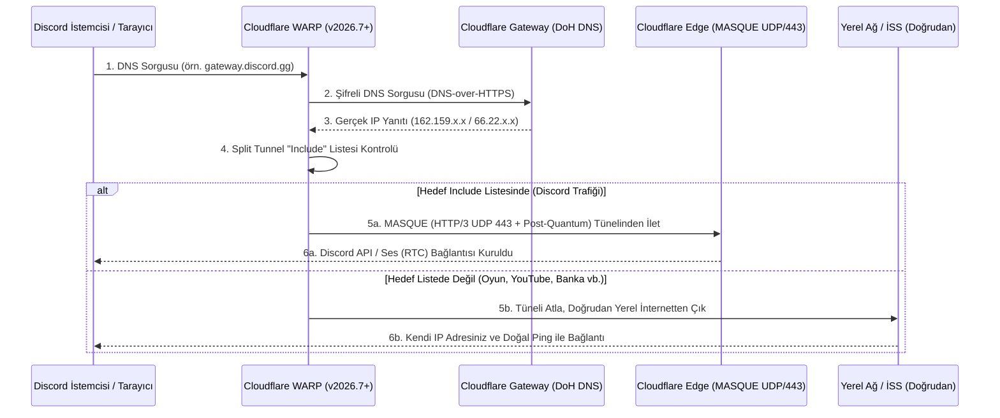

# Zero Trust Modeli, Protokol Analizi ve Kurulum Mimarisi

  <b>🌐 Dil / Language:</b> 🇹🇷 <b>Türkçe</b> | <a href="en/01-what-is-zero-trust.md">🇬🇧 English</a>

---

| Alan | Değer |
|---|---|
| **Belge kimliği** | ZT-001 |
| **Sürüm** | 2.0 (Cloudflare One & WARP v2026.7+) |
| **Yayım tarihi** | 20.11.2026 |
| **İlgili belgeler** | [ZT-002](02-cloudflare-kurulumu.md), [ZT-003](03-ip-ve-dns.md), [ZT-004](04-warp-kurulumu.md) |

## 1. Amaç

Bu belge, kurulumun dayandığı **Zero Trust Network Access (ZTNA)** modelini, kullanılan Cloudflare One bileşenlerini ve tasarım kararlarının (özellikle **Split Tunnel Include modu** ve **MASQUE vs WireGuard tünel protokolü seçimi**) teknik gerekçelerini açıklar.

## 2. Zero Trust modeli

### 2.1 Tanım

Zero Trust, bir ağın içinde bulunmanın güven için yeterli sayılmadığı modern siber güvenlik yaklaşımıdır (**"Asla güvenme, daima doğrula"** / *"Never trust, always verify"*). Geleneksel çevre güvenliği modellerinde ağ sınırı güvenilir kabul edilir ve sınırın içindeki trafik büyük ölçüde denetlenmez. Zero Trust bu varsayımı ortadan kaldırır: her erişim isteği, kaynağına ve hedefine bakılmaksızın kimlik, cihaz durumu ve politika koşullarına göre yeniden değerlendirilir.

### 2.2 Temel ilkeler

1. **Kimlik tabanlı erişim:** Erişim kararı; kullanıcı kimliği (e-posta OTP doğrulaması), cihaz kaydı ve bağlantı bağlamı üzerinden verilir.
2. **En az yetki (Least Privilege):** Kullanıcı ve cihaz, yalnızca tanımlı kaynaklara ve tanımlı süre boyunca erişir.
3. **Sürekli doğrulama:** Erişim, oturum başında bir kez verilen kalıcı bir izin değildir; oturum boyunca koşullar yeniden değerlendirilir.
4. **Ağ segmentasyonu (Split Tunneling):** Trafik, uygulama ve hedef bazında ayrıştırılır; yalnızca tünellenmesi istenen hedefler şifreli tünele alınır.
5. **Görünürlük ve denetim:** Tüm erişim kararları ve cihaz kayıtları panel üzerinden izlenebilir.

Bu kurulumda ilkelerden özellikle **ikincisi ve dördüncüsü** belirleyicidir: cihazın tüm internet trafiği değil, yalnızca Discord'a ait 164 hedef (alan adları, CDN, ses/RTC sunucuları) tünele alınır.

## 3. ZTNA ve geleneksel VPN karşılaştırması

| Ölçüt | Geleneksel VPN | Zero Trust (ZTNA — Split Tunnel Include) |
|---|---|---|
| **Erişim kararı** | Ağa bağlanan herkes güvenilir kabul edilir | Her cihaz ve kullanıcı e-posta politikası ile doğrulanır |
| **Kaynak kapsamı** | Tünel üzerinden tüm ağa erişim | Yalnızca tanımlı uygulama ve hedefler (Discord) |
| **Trafik kapsamı** | Genellikle tüm sistem trafiği tünellenir | Seçili hedefler tünellenir (`Include IPs and domains` modu) |
| **Oyun ve yerel gecikme (Ping)** | Tüm oyunlar ve uygulamalar VPN sunucusuna uzar | Oyunlar ve diğer siteler kendi yerel internetinizden doğrudan çıkar (0 ek ping) |
| **DPI / Port engeli dayanımı** | Standart OpenVPN/WireGuard portları kolayca engellenir | **MASQUE** (`UDP/443`, HTTP/3) ile standart HTTPS web trafiğinden ayırt edilemez |

## 4. Kullanılan Cloudflare One bileşenleri

| Bileşen | Güncel Panel Konumu | İşlev ve Rolü |
|---|---|---|
| **Team Domain (Organizasyon)** | `Zero Trust > Settings > Team domain` | `<takim-adi>.cloudflareaccess.com` altında cihaz kaydının yapıldığı çatı yapı |
| **Access Politikası** | `Zero Trust > Access controls > Policies` | Hangi e-posta adreslerinin WARP istemcisini organizasyona kaydedebileceğini belirler |
| **Device Enrollment İzni** | `Zero Trust > Team & Resources > Devices > Management` | Oluşturulan Access politikasını WARP cihaz kayıtlarına bağlar |
| **Device Profile (`Default`)** | `Zero Trust > Team & Resources > Devices > Device profiles` | Servis modu (`Traffic and DNS`), tünel protokolü (`MASQUE`) ve Split Tunnel ayarlarını barındırır |
| **Split Tunnel (`Include`)** | `Device profiles > Default > Split tunnels` | Yalnızca listedeki 84 Discord alan adı ve 80 IP/CIDR bloğunun tünellenmesini sağlar |
| **MASQUE Protokolü** | `Device profiles > Default > Edit profile settings` | Tünel paketlerini kuantum sonrası şifreleme ile HTTP/3 üzerinden `UDP/443` portuyla taşır |

## 5. Cloudflare Tunnel (`cloudflared`) ile WARP farkı

Cloudflare'in iki farklı ürünü sıkça karıştırılmaktadır. Bu kurulumda kullanılan ürün **Cloudflare One Client (WARP)** istemcisidir; **Cloudflare Tunnel (`cloudflared`) kullanılmaz**.

| Ürün | Trafik yönü | Kullanım amacı |
|---|---|---|
| **Cloudflare Tunnel (`cloudflared`)** | Gelen (Inbound) | Kendi sunucunuzda çalışan bir web sitesini/hizmeti dış internete açar |
| **WARP + Zero Trust** | Giden (Outbound) | Bilgisayarınızın dışarıya giden trafiğini Cloudflare edge ağı üzerinden yönlendirir |

## 6. Trafik akışı

## 7. Tasarım kararları ve neden MASQUE protokolü daha iyidir?

### 7.1 Split Tunnel modunun "Include IPs and domains" seçilmesi

- **Include modunda** yalnızca listede tanımlı hedefler tünele girer.
- **Exclude modunda** liste dışındaki **tüm bilgisayar trafiği** tünellenir.
- Discord odaklı bir kurulumda **Include IPs and domains** modu tercih edilir; çünkü çevrimiçi oyunların, yayın platformlarının veya yerel ağ cihazlarının trafiği etkilenmez ve tünel üzerindeki yük asgari düzeyde kalır.

### 7.2 Alan adı ve IP/CIDR kurallarının birlikte kullanılması

Alan adı kuralları işletim sisteminin ve WARP'ın DNS çözümlemesine bağlıdır. Bazı ağlarda DNS yanıtının değiştirilmesi (DNS poisoning), önbelleklenmesi veya Discord ses sunucularının doğrudan IP adresi üzerinden UDP soketi açması nedeniyle alan adı kuralları tek başına yeterli olmaz. Bu nedenle:
- Web, API ve CDN için **84 alan adı** (`discord.com`, `*.discord.gg`, `*.discordapp.net` vb.),
- Ön yüz ve CDN için **32 Cloudflare anycast IPv4 bloğu** (`162.159.128.0/19`, `104.18.0.0/20` vb.),
- Ses, görüntü ve ekran paylaşımı (WebRTC) için **32 Discord RTC IPv4 bloğu** (`66.22.196.0/22` - `66.22.248.0/24`),
- Ek yükleme ve arka uç servisleri için **11 Google Cloud IPv4 bloğu** (`34.x`, `35.x`) birlikte tanımlanır.

### 7.3 Tünel protokolü karşılaştırması: Neden WireGuard yerine MASQUE seçilmeli?

Cloudflare Zero Trust (`Edit "Default" profile > Device tunnel protocol`) ekranında iki protokol bulunur: **MASQUE (`Recommended`)** ve **WireGuard**.

**MASQUE (Multiplexed Application Substrate over QUIC Encryption)** protokolünün WireGuard'a kıyasla çok daha üstün olmasının teknik nedenleri şunlardır:

1. **DPI ve Port Engellerine Karşı Tam Görünmezlik (`UDP/443` vs `UDP/2408`):**
   - **WireGuard**, varsayılan olarak `UDP/2408` (veya belirli sabit UDP portları) üzerinde çalışır ve kendine özgü açık bir el sıkışma (handshake) paket yapısına sahiptir. İnternet servis sağlayıcıları (İSS), okul/yurt ağları ve kurumsal güvenlik duvarları DPI (Deep Packet Inspection) ile WireGuard paketlerini saniyeler içinde tespit edip daraltabilir (throttling) veya tamamen engelleyebilir.
   - **MASQUE** ise IETF standardı bir protokoldür ve trafiği **HTTP/3 (QUIC) üzerinde `UDP/443`** portundan taşır. Dışarıdan bakıldığında herhangi bir modern web sitesine (Google, YouTube, Cloudflare) yapılan standart bir HTTPS/QUIC bağlantısından **ayırt edilemez**.
2. **Otomatik HTTP/2 (`TCP/443`) Fallback Desteği:**
   - Güncel WARP `v2026.7+` istemcisinde (`warp-cli settings` çıktısında `HTTP Version: MASQUE (HTTP/3 with HTTP/2 fallback)` olarak görülür), bulunduğunuz ağda tüm UDP trafiği tamamen kapatılmış olsa bile MASQUE otomatik olarak `TCP/443` (HTTP/2) üzerinden tünel kurmaya devam eder. WireGuard yalnızca UDP tabanlı olduğu için UDP engelli ağlarda tamamen çalışmaz hale gelir.
3. **Discord Ses Kanallarında (`RTC Connecting`) Kesintisiz Performans:**
   - WireGuard kullanıldığında İSS tarafındaki UDP daraltmaları yüzünden Discord metin kanalları açılsa bile ses kanalları **`RTC Connecting`** aşamasında takılı kalır veya ses kesik kesik gider. MASQUE, QUIC çoklama (multiplexing) mimarisiyle Discord WebRTC ses/yayın paketlerini kayıpsız taşır.
4. **Kuantum Sonrası Şifreleme (Post-Quantum Cryptography — PQC):**
   - Cloudflare One panelinde de belirtildiği üzere (*"The default protocol with post-quantum cryptography and support for all Cloudflare One Client features"*), MASQUE varsayılan olarak kuantum bilgisayar saldırılarına dayanıklı hibrit anahtar değişimini (`ML-KEM` / `X25519MLKEM768`) destekler.
5. **Tüm Cloudflare One İstemci Özellikleriyle Tam Uyum:**
   - Panelde WireGuard seçeneğinin altında açıkça *"Some Cloudflare One Client features are unavailable, including Local proxy mode"* uyarısı yer alır. MASQUE tüm modern Zero Trust özelliklerini eksiksiz destekler.

> [!TIP]
> **Ne zaman WireGuard kullanılır?** Yalnızca çok eski bir WARP istemci sürümü kullanıyorsanız veya ağınızdaki eski bir kurumsal donanım güvenlik duvarı QUIC (`UDP/443`) protokolünü bozuyorsa alternatif olarak WireGuard seçilebilir. Bunun dışındaki tüm güncel kurulumlarda **MASQUE** kullanılmalıdır.

## 8. Sınırlamalar

- Kurulum, cihazın listedeki hedeflere giden trafiğini Cloudflare ağı üzerinden yönlendirir; trafik Cloudflare'in en yakın bölgesel veri merkezlerinden çıkar.
- Adres envanterinde yer alan `162.159.128.0/19` ve `104.18.0.0/20` gibi geniş Cloudflare anycast blokları, aynı IP bloğunu paylaşan Discord dışındaki bazı Cloudflare sitelerinin de tünel üzerinden geçmesine neden olabilir (detaylar için bkz. [ZT-003](03-ip-ve-dns.md)).
- Cloudflare Zero Trust ücretsiz planı **50 kullanıcıya** kadar ücretsizdir.

## 9. İlgili belgeler

- Sonraki adım (Panel Kurulumu): [02-cloudflare-kurulumu.md](02-cloudflare-kurulumu.md)
- Adres envanteri: [03-ip-ve-dns.md](03-ip-ve-dns.md)
- İstemci kurulumu: [04-warp-kurulumu.md](04-warp-kurulumu.md)
