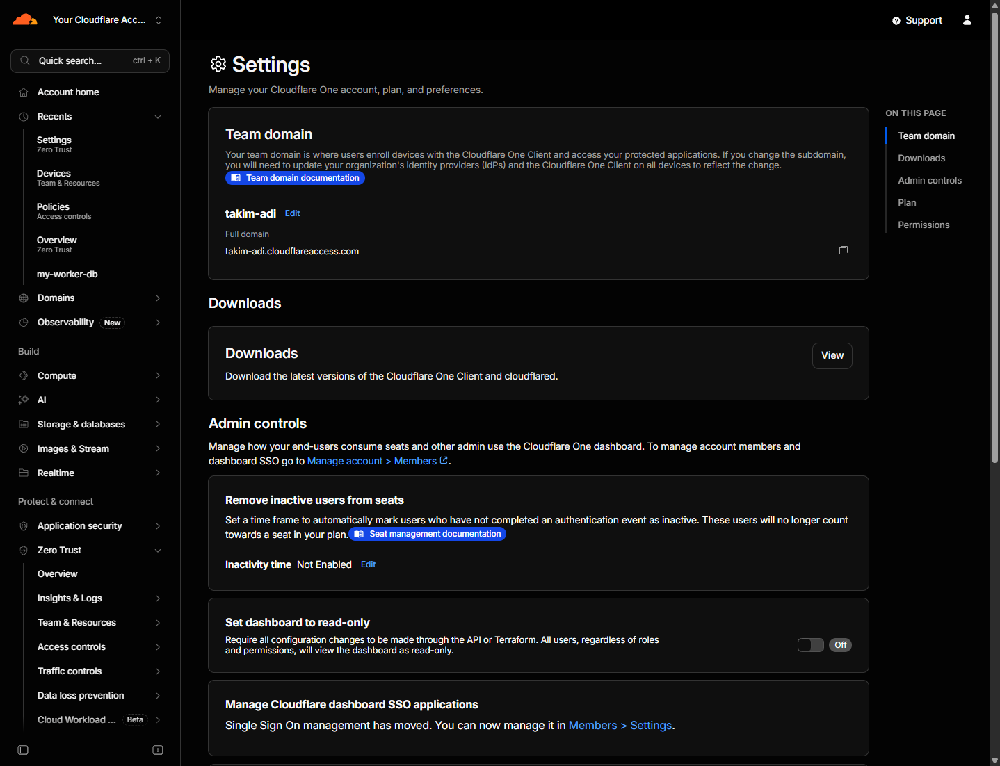
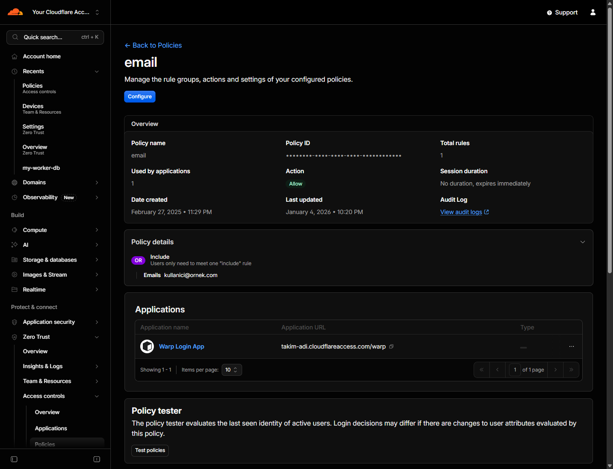
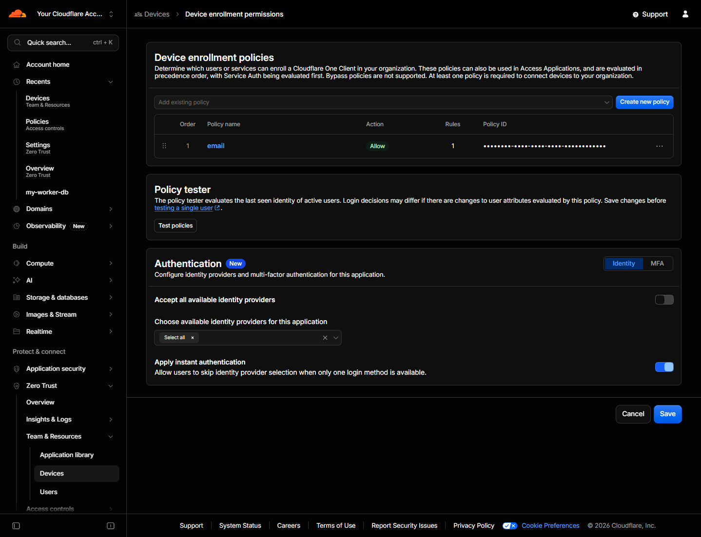
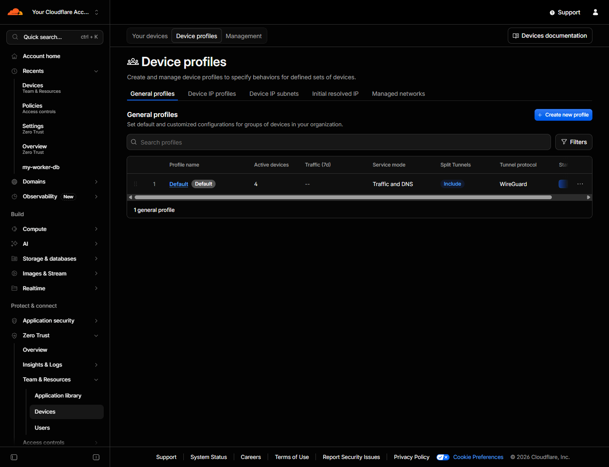
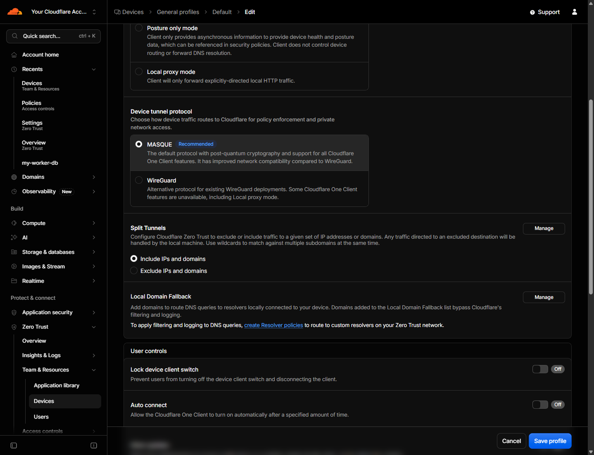

# Cloudflare Zero Trust (Cloudflare One) Panel Yapılandırması

  <b>🌐 Dil / Language:</b> 🇹🇷 <b>Türkçe</b> | <a href="en/02-cloudflare-setup.md">🇬🇧 English</a>

---

| Alan | Değer |
|---|---|
| **Belge kimliği** | ZT-002 |
| **Sürüm** | 2.0 (Güncel Cloudflare One Paneli) |
| **Yayım tarihi** | 20.11.2026 |
| **Tahmini süre** | 10 - 15 dakika |
| **İlgili belgeler** | [ZT-001](01-zero-trust-nedir.md), [ZT-003](03-ip-ve-dns.md), [ZT-004](04-warp-kurulumu.md), [ZT-006](06-otomasyon.md) |

## 1. Amaç

Bu belge, en güncel Cloudflare Zero Trust (**Cloudflare One**) panelinde yapılması gereken yapılandırmayı gerçek ve güncel ekran görüntüleri ile adım adım tanımlar. Prosedür tamamlandığında organizasyon (`Team domain`), erişim politikası (`Access controls > Policies`), cihaz kayıt izni (`Device enrollment`), Split Tunnel Include listesi ve **MASQUE** tünel protokolü hazır durumda olur.

## 2. Ön koşullar

- Cloudflare hesabı (<https://dash.cloudflare.com> üzerinden ücretsiz oluşturulabilir)
- Zero Trust hizmetine erişim yetkisi
- [ZT-003](03-ip-ve-dns.md) belgesindeki adres envanteri (veya otomatik yükleme için [ZT-006](06-otomasyon.md) betiği)
- Discord uygulaması kurulum boyunca **kapalı** olmalıdır (doğrulama sonrası açılacaktır)

---

## 3. Organizasyonun ve Takım Alan Adının (`Team domain`) oluşturulması

### 3.1 Hesap ve Zero Trust paneline giriş

1. <https://dash.cloudflare.com> adresine giriş yapın.
2. Sol menüdeki **Protect & connect** başlığı altından **Zero Trust** bölümüne tıklayın.
3. Hizmet ilk kez kullanılıyorsa kurulum sihirbazı (Onboarding) başlayacaktır; bir takım adı belirleyip **Zero Trust Free** ($0/ay, 50 kullanıcıya kadar ücretsiz) planını seçin.

### 3.2 Takım adının (`Team domain`) kontrol edilmesi

1. Sol menüden **Zero Trust > Settings** sayfasına gidin.
2. **Team domain** kartında takım adınızın (`<takim-adi>.cloudflareaccess.com`) tanımlı olduğunu doğrulayın:

- **Önemli:** Burada görünen `<takim-adi>` (örneğin `takim-adi.cloudflareaccess.com` adresindeki ilk kısım), bilgisayarınızdaki WARP istemcisini Zero Trust moduna kaydederken kullanacağınız addır.

---

## 4. Erişim politikasının (`Access controls > Policies`) tanımlanması

Zero Trust, güvenlik gereği varsayılan olarak hiçbir cihazın takımınıza kaydedilmesine izin vermez. Bilgisayarınızı takımınıza bağlayabilmek için önce e-posta adresinize izin veren bir erişim politikası oluşturmalısınız.

### 4.1 Yeni politika oluşturma

1. Sol menüden **Zero Trust > Access controls > Policies** bölümüne gidin (`Reusable policies` sekmesi).
2. Sağ üstteki **+ Add a policy** düğmesine tıklayın (veya mevcut politikanızı **Configure** ile düzenleyin).
3. Politika alanlarını aşağıdaki gibi yapılandırın:

| Alan | Değer | Açıklama |
|---|---|---|
| **Policy Name** | `email` veya `discord-enroll` | Politikanızı tanımak için verilen isim |
| **Action** | `Allow` | Eşleşen kullanıcıların cihaz kaydetmesine izin verir |
| **Session duration** | `No duration, expires immediately` veya `24 hours` | Kayıt oturum süresi |
| **Policy rules > Include** | `Selector: Emails` → `Value: kullanici@ornek.com` | WARP istemcisine giriş yaparken tek kullanımlık doğrulama kodu (OTP) alacağınız kendi e-posta adresiniz |

4. Politikayı kaydedin.

---

## 5. Cihaz kayıt izninin (`Device enrollment permissions`) bağlanması

Oluşturduğumuz erişim politikasını şimdi Cloudflare One / WARP cihaz kayıtlarına bağlamamız gerekiyor.

> [!IMPORTANT]
> Bu adım atlandığında WARP istemcisi takımınıza kaydolamaz ve giriş sırasında **"Forbidden"** veya **"Unable to connect"** hatası verir.

1. Sol menüden **Zero Trust > Team & Resources > Devices** bölümüne gidin.
2. Üstteki sekmelerden **Management** sekmesine geçin.
3. **Device enrollment > Device enrollment permissions** karşısındaki **Manage** düğmesine tıklayın.
4. **Device enrollment policies** tablosunda `Add existing policy` kutusundan az önce oluşturduğunuz politikayı (`email` / `discord-enroll`) seçip ekleyin:

5. Sağ alttaki **Save** düğmesine basarak kaydedin.

---

## 6. Cihaz Profili, MASQUE Protokolü ve Split Tunnel Yapılandırması

Varsayılan olarak WARP tüm internet trafiğinizi tüneller. Oyunlarda ping olmaması, yalnızca Discord'un tünelden geçmesi ve İSS/DPI engellerine takılmamak için **Default** cihaz profilini yapılandıracağız.

### 6.1 Default cihaz profilini açma

1. Sol menüden **Zero Trust > Team & Resources > Devices** sayfasına dönün ve üstten **Device profiles** sekmesine tıklayın.
2. **General profiles** tablosunda yer alan **Default** profiline tıklayın (veya sağındaki `⋯` menüsünden düzenleyin):

3. Açılan **Default** profil sayfasında sağ üstteki **Edit profile settings** düğmesine tıklayın.

### 6.2 Servis modu ve Tünel protokolünün MASQUE (`Recommended`) seçilmesi

`Edit "Default" profile` sayfasında ilk olarak **Service mode** ve **Device tunnel protocol** ayarları yer alır:

1. **Service mode:** **`Traffic and DNS mode`** seçili olmalıdır (hem Discord IP/port trafiğini yönlendirir hem de DNS sorgularını Cloudflare DoH üzerinden çözer).
2. **Device tunnel protocol:** **`MASQUE` (`Recommended`)** seçeneğini işaretleyin.

#### Neden WireGuard yerine MASQUE seçilmeli? (Detaylı Karşılaştırma)

Güncel Cloudflare One panelinde **MASQUE** protokolünün yanında **`Recommended` (Önerilen)** etiketi yer alır ve açıklama kısmında *"The default protocol with post-quantum cryptography and support for all Cloudflare One Client features. It has improved network compatibility compared to WireGuard."* ifadesi bulunur.

- **Neden MASQUE Daha İyi?**
  1. **Standart HTTPS/QUIC Görünümü (`UDP/443`):** WireGuard `UDP/2408` portunu kullanır ve İSS'lerin DPI (Derin Paket İnceleme) sistemleri tarafından kolayca tespit edilip engellenebilir veya yavaşlatılabilir. **MASQUE** ise trafiği `UDP/443` üzerinden **HTTP/3 (QUIC)** protokolüyle taşır; bu sayede normal bir web sitesine (HTTPS) bağlanıyormuşsunuz gibi görünür ve ağ engellerine takılmaz.
  2. **Otomatik HTTP/2 (`TCP/443`) Yedeklemesi (Fallback):** Ağınızda UDP tamamen engellense bile MASQUE otomatik olarak `TCP/443` (HTTP/2) moduna düşerek bağlantıyı koparmaz.
  3. **Discord Ses (`RTC Connecting`) Çözümü:** Ses kanallarında yaşanan `RTC Connecting` takılmalarının ve ses kopmalarının en büyük nedeni WireGuard UDP paketlerinin düşürülmesidir. MASQUE bu sorunu ortadan kaldırır.
  4. **Kuantum Sonrası Şifreleme (Post-Quantum Cryptography):** MASQUE, kuantum bilgisayar saldırılarına karşı gelişmiş şifreleme (`ML-KEM`) içerir ve tüm Cloudflare One istemci özelliklerini destekler (WireGuard seçildiğinde panelde uyarıldığı üzere `Local proxy mode` gibi bazı özellikler devre dışı kalır).

### 6.3 Split Tunnels modunu "Include IPs and domains" yapma

1. Aynı `Edit "Default" profile` sayfasında biraz aşağı kaydırarak **Split Tunnels** bölümüne gelin.
2. Modu **`Include IPs and domains`** olarak işaretleyin ve sağ alttaki **Save profile** düğmesine basarak profili kaydedin:

| Mod | Davranış | Bu Kurulumdaki Tercih |
|---|---|---|
| **Exclude IPs and domains** | Listede olmayan **tüm sistem trafiği** tünellenir | ❌ Kullanılmaz |
| **Include IPs and domains** | **Yalnızca listede olan** IP ve alan adları tünellenir | ✅ **Seçilmesi gereken mod** |

---

## 7. Discord IP ve alan adı kayıtlarının eklenmesi

> [!TIP]
> **Otomatik Yükleme (Önerilen):** 164 adet IP ve alan adını tek tek elle yapıştırmak yerine, yukarıdaki **Include IPs and domains** ve **MASQUE** seçimini kaydettikten sonra [06-otomasyon.md](06-otomasyon.md) rehberindeki `Apply-DiscordZeroTrust.ps1` betiğini çalıştırarak tüm 164 kuralı **10 saniyede otomatik** yükleyebilirsiniz!

Kayıtları panel üzerinden **manuel** eklemek istiyorsanız:

1. `Devices > General profiles > Default` sayfasında üstteki **Split tunnels** sekmesine geçin (veya profil düzenleme ekranında Split Tunnels karşısındaki **Manage** düğmesine basın).
2. Sağ üstteki **Add split tunnel entries** düğmesine tıklayın:

3. Açılan **Add split tunnel entries** formunda:
   - **IP adresi veya CIDR bloğu** (örn. `162.159.128.0/19`, `66.22.192.0/18`) eklerken: **Selector** olarak **`IP Address`** seçin, **Value** kısmına IP/CIDR değerini yazıp **Add to list** düğmesine basın.
   - **Alan adı** (örn. `discord.com`, `*.discord.com`, `*.discord.gg`) eklerken: **Selector** olarak **`Domain`** seçin, **Value** kısmına alan adını yazıp **Add to list** düğmesine basın.
4. Tüm kayıtları listeye ekledikten sonra sağ alttaki **Save entries** düğmesine basarak kaydedin.

---

## 8. Yapılandırma kontrol listesi

WARP istemci kurulumuna ([ZT-004](04-warp-kurulumu.md)) geçmeden önce paneldeki ayarlarınızı aşağıdaki tablo ile doğrulayın:

| No | Denetim Noktası | Güncel Menü Konumu | Beklenen Durum |
|---|---|---|---|
| **1** | Takım alan adı | `Zero Trust > Settings > Team domain` | `<takim-adi>.cloudflareaccess.com` aktif |
| **2** | Erişim politikası | `Zero Trust > Access controls > Policies` | `Allow` kuralı ve e-posta adresiniz tanımlı |
| **3** | Cihaz kayıt izni | `Zero Trust > Team & Resources > Devices > Management` | `Device enrollment permissions` altında politikanız ekli |
| **4** | Tünel protokolü | `Devices > Device profiles > Default > Edit profile settings` | **MASQUE (`Recommended`)** |
| **5** | Split Tunnel modu | `Devices > Device profiles > Default > Edit profile settings` | **Include IPs and domains** |
| **6** | Adres envanteri | `Devices > Device profiles > Default > Split tunnels` | En az 15 kayıtlık hızlı set veya 164 tam kayıt yüklü |

## 9. Sık karşılaşılan yapılandırma hataları

| Hata | Etki | Çözüm |
|---|---|---|
| Cihaz kayıt izninin (`Device enrollment permissions`) bağlanmaması | WARP takım adını kabul etmez veya e-posta sonrası `Forbidden` verir | Bölüm 5'teki gibi politikanızı `Devices > Management > Device enrollment permissions` altına ekleyin |
| Split Tunnel modunun `Exclude` bırakılması | Discord tünellenmez veya tüm bilgisayar trafiği tünele girer | Bölüm 6.3'teki gibi `Include IPs and domains` yapın |
| Alan adının `IP Address` seçili iken girilmesi | Panel kabul etmez veya kural çalışmaz | Alan adları için `Selector: Domain`, IP'ler için `Selector: IP Address` seçin |
| Protokolün `WireGuard` bırakılması | Ses kanalları `RTC Connecting`'de kalır veya UDP/2408 engeline takılır | Bölüm 6.2'deki gibi `MASQUE (Recommended)` seçip profili kaydedin |

## 10. İlgili belgeler

- Önceki belge (Mimari & Protokol Analizi): [01-zero-trust-nedir.md](01-zero-trust-nedir.md)
- Adres ve alan adı listesi: [03-ip-ve-dns.md](03-ip-ve-dns.md)
- Sonraki adım (WARP İstemci Kurulumu): [04-warp-kurulumu.md](04-warp-kurulumu.md)
- Otomatik API kurulumu: [06-otomasyon.md](06-otomasyon.md)
