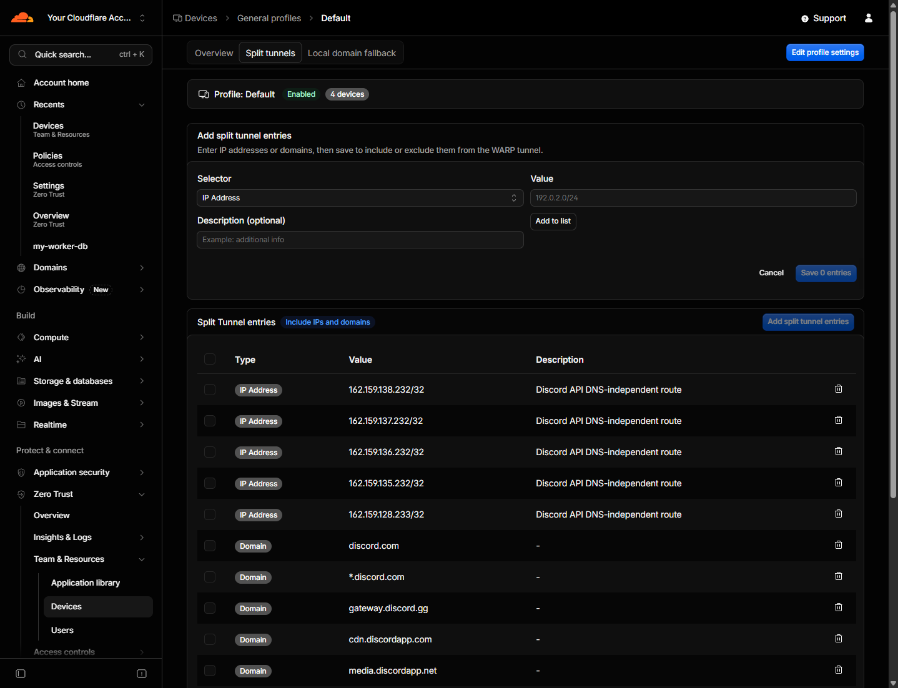

# Adres ve Alan Adı Envanteri

<div align="right">
  <b>🌐 Dil / Language:</b> 🇹🇷 <b>Türkçe</b> | <a href="en/03-ip-and-dns.md">🇬🇧 English</a>
</div>

---

| Alan | Değer |
|---|---|
| **Belge kimliği** | ZT-003 |
| **Sürüm** | 1.1 |
| **Yayım tarihi** | 20.11.2026 |
| **Toplam kayıt** | 164 (84 Alan Adı + 76 IPv4 + 4 IPv6) |
| **İlgili belgeler** | [ZT-002](02-cloudflare-kurulumu.md), [ZT-004](04-warp-kurulumu.md), [ZT-006](06-otomasyon.md) |

## 1. Amaç

Bu belge, Cloudflare Zero Trust Split Tunnel (**Include IPs and domains**) yapılandırmasında kullanılacak hedeflerin envanterini tanımlar. Envanter iki düzeyde sunulur:
1. **Hızlı Kurulum Seti (15 Kayıt):** Panel üzerinden elle kurulum yapanlar için geniş CIDR bloklarıyla tüm Discord web ve ses trafiğini kapsayan asgari liste.
2. **Tam Envanter (164 Kayıt):** Tüm alt alan adlarını, CDN, Google Cloud ve ses/RTC sunucularını tek tek kapsayan eksiksiz liste (`scripts/discord-routes.txt` ve `Apply-DiscordZeroTrust.ps1` ile otomatik uygulanabilir).

## 2. Sınıflandırma

| Grup | Kayıt sayısı | Selector Türü | Kapsam |
|---|---:|---|---|
| **Alan adları** | 84 | `Domain` | Web, API, Gateway, CDN, güncelleme, etkinlik ve davet alan adları |
| **Cloudflare anycast (IPv4)** | 32 | `IP Address` | Discord ön yüz, Gateway ve CDN blokları (`162.159.x`, `104.x`) |
| **Discord ses / RTC (IPv4)** | 32 | `IP Address` | Ses, görüntü ve ekran paylaşımı (WebRTC) uç noktaları (`66.22.x`) |
| **Google Cloud (IPv4)** | 11 | `IP Address` | Discord'un Google Cloud üzerindeki medya/arka uç bileşenleri (`34.x`, `35.x`) |
| **IPv6** | 4 | `IP Address` | Cloudflare IPv6 blokları (isteğe bağlı) |
| **Diğer** | 1 | `IP Address` | Tekil uç nokta (`198.244.231.90/32`) |
| **Toplam** | **164** | | |

Kayıtlar panelde iki türde girilir: IP ve CIDR blokları **`IP Address`**, alan adları **`Domain`** olarak tanımlanır. Joker kayıtlar (`*.alanadi`) alt alan adlarını kapsar.



## 3. Envanterin kaynağı

Envanter üç kaynaktan derlenmiştir:
1. Discord masaüstü ve web istemcisinin kullandığı kamuya açık alan adları.
2. Cloudflare ve Discord'un yayımladığı anycast ve ses/RTC ASN blokları.
3. Açık kaynak yapılandırma araçlarının (`WarpZeroTrustConfigure`) doğrulanmış rota listesi.

---

## 4. Hızlı kurulum seti (15 Kayıt - Manuel Kurulum İçin Önerilen)

Panel üzerinden 164 kaydın tek tek girilmesi zaman aldığından, elle kurulum yapan kullanıcılar için aşağıdaki **15 kayıtlık Hızlı Kurulum Seti** yeterlidir. Geniş CIDR blokları (`/18`, `/19`, `/20`) sayesinde tam listedeki tüm alt blokları tek seferde kapsar.

| Kayıt | Selector Türü | Kapsam |
|---|---|---|
| `162.159.128.0/19` | `IP Address` | `162.159.128.0 - 162.159.159.255` aralığı; envanterdeki tüm `162.159.x` kayıtlarını kapsar |
| `66.22.192.0/18` | `IP Address` | `66.22.192.0 - 66.22.255.255` aralığı; ses/RTC bloklarının tamamını kapsar |
| `104.18.0.0/20` | `IP Address` | Cloudflare CDN bloğu |
| `104.16.51.111/32` | `IP Address` | Sabit CDN uç noktası |
| `104.18.48.115/32` | `IP Address` | Sabit CDN uç noktası |

### 4.1 Hızlı Set — Alan adları (`Selector: Domain` — 10 Kayıt)

```text
discord.com
*.discord.com
discord.gg
*.discord.gg
discordapp.com
*.discordapp.com
discordapp.net
*.discordapp.net
discord.media
*.discord.media
```

### 4.2 Hızlı Set — IP ve CIDR (`Selector: IP Address` — 5 Kayıt)

```text
162.159.128.0/19
66.22.192.0/18
104.18.0.0/20
104.16.51.111/32
104.18.48.115/32
```

> [!TIP]
> Ses kanallarında kopma, ekran paylaşımı gecikmesi veya harici medya/etkinlik yüklenmesinde sorun görülürse Bölüm 5'teki **164 kurallık Tam Envantere** geçilmelidir ([06-otomasyon.md](06-otomasyon.md) ile otomatik yüklenebilir).

---

## 5. Tam envanter (164 Kayıt)

Bu liste `scripts/discord-routes.txt` dosyası ile birebir aynıdır.

### 5.1 Alan adları (`Selector: Domain` — 84 Kayıt)

```text
*.bigbeans.solutions
*.daveprotocol.com
*.dis.gd
*.discord-activities.com
*.discord.co
*.discord.com
*.discord.design
*.discord.dev
*.discord.fr
*.discord.gg
*.discord.gift
*.discord.gifts
*.discord.media
*.discord.new
*.discord.store
*.discord.tools
*.discordactivities.com
*.discordapp.com
*.discordapp.io
*.discordapp.net
*.discordcdn.com
*.discordmedia.com
*.discordmerch.com
*.discordpartygames.com
*.discordsays.com
*.discordsez.com
*.discordstatus.com
*.discordusercontent.com
*.updates.discord.com
*.watchanimeattheoffice.com
airhorn.solutions
airhornbot.com
bigbeans.solutions
canary.discord.com
cdn.discordapp.com
cdn.discordapp.net
click.discord.com
collector.discord.com
daveprotocol.com
dfr.gg
dis.gd
discord-activities.com
discord-attachments-uploads-prd.storage.googleapis.com
discord.app
discord.co
discord.com
discord.design
discord.dev
discord.fr
discord.gg
discord.gift
discord.gifts
discord.media
discord.new
discord.store
discord.tools
discordactivities.com
discordapp.com
discordapp.io
discordapp.net
discordcdn.com
discordmerch.com
discordpartygames.com
discordsays.com
discordsez.com
discordstatus.com
dl.discordapp.net
fonts.discord.com
gateway-us-east1-b.discord.gg
gateway.discord.gg
gateway.discord.media
i.dis.gd
images-ext-1.discordapp.net
images-ext-2.discordapp.net
media.discordapp.net
ptb.discord.com
push.discord.com
remote-auth-gateway.discord.gg
software-update.discord.com
status.discord.com
support.discord.com
updates.discord.com
versions.discord.com
watchanimeattheoffice.com
```

### 5.2 Cloudflare anycast, IPv4 (`Selector: IP Address` — 32 Kayıt)

```text
104.16.51.111/32
104.18.0.0/20
104.18.48.115/32
162.159.128.0/19
162.159.128.0/24
162.159.128.0/25
162.159.128.233/32
162.159.128.234/31
162.159.128.236/30
162.159.128.240/28
162.159.129.0/24
162.159.129.233/32
162.159.130.0/23
162.159.130.233/32
162.159.130.234/32
162.159.132.0/22
162.159.133.233/32
162.159.133.234/32
162.159.134.233/32
162.159.134.234/32
162.159.135.232/32
162.159.135.233/32
162.159.135.234/32
162.159.136.0/23
162.159.136.232/32
162.159.136.234/32
162.159.137.232/32
162.159.138.0/25
162.159.138.128/26
162.159.138.192/27
162.159.138.224/29
162.159.138.232/32
```

### 5.3 Discord ses / RTC, IPv4 (`Selector: IP Address` — 32 Kayıt)

```text
66.22.196.0/22
66.22.200.0/22
66.22.204.0/22
66.22.208.0/22
66.22.212.0/22
66.22.216.0/23
66.22.218.0/23
66.22.220.0/23
66.22.222.0/23
66.22.224.0/23
66.22.226.0/23
66.22.230.0/24
66.22.231.0/24
66.22.232.0/24
66.22.233.0/24
66.22.234.0/24
66.22.235.0/24
66.22.236.0/24
66.22.237.0/24
66.22.238.0/24
66.22.239.0/24
66.22.240.0/24
66.22.241.0/24
66.22.242.0/24
66.22.243.0/24
66.22.243.155/32
66.22.244.0/24
66.22.244.37/32
66.22.245.0/24
66.22.246.0/24
66.22.247.0/24
66.22.248.0/24
```

### 5.4 Google Cloud, IPv4 (`Selector: IP Address` — 11 Kayıt)

```text
34.0.240.0/20
34.124.0.0/14
35.186.224.24/32
35.186.224.45/32
35.207.192.0/18
35.213.0.0/17
35.213.128.0/18
35.213.192.0/18
35.214.128.0/17
35.215.128.0/18
35.215.192.0/18
```

### 5.5 IPv6 (`Selector: IP Address` — 4 Kayıt, İsteğe Bağlı)

```text
2400:cb00::/32
2405:8100::/32
2606:4700::/32
2a06:98c0::/29
```

### 5.6 Diğer (`Selector: IP Address` — 1 Kayıt)

```text
198.244.231.90/32
```

---

## 6. Adres seçiminin gerekçesi

- **Sabit IP kayıtları (`/32`):** Alan adı kuralları DNS yanıtına bağlıdır. DNS yanıtının değiştirildiği ağlarda alan adı kuralı yanlış adrese yönlendirme yapabilir. Kritik uç noktaların sabit IP olarak tanımlanması, çözümleme sonucundan bağımsız olarak trafiğin tünele girmesini sağlar.
- **Geniş anycast blokları:** Discord, Cloudflare anycast ağı üzerinden hizmet verir. Tek tek IP tanımlamak yerine bloğun tamamının tanımlanması, IP rotasyonlarında yapılandırmanın geçerliliğini korur.
- **Ses/RTC blokları (`66.22.x.x`):** Ses ve görüntü trafiği, web trafiğinden farklı olarak doğrudan Discord'un kendi ASN'ine ait UDP sunucularından çıkar. Bu bloklar tanımlanmadığında metin mesajları çalışırken ses kanalları **"RTC Connecting"** aşamasında takılı kalır.

## 7. Bakım ve doğrulama

Envanter, Discord altyapısındaki değişikliklere bağlı olarak periyodik kontrol edilebilir:

```powershell
Resolve-DnsName discord.com -Type A | Select-Object -ExpandProperty IPAddress
Resolve-DnsName gateway.discord.gg -Type A | Select-Object -ExpandProperty IPAddress
```

Dönen adreslerin `162.159.128.0/19` veya `66.22.192.0/18` blokları içinde olduğunu doğrulayın.

## 8. İlgili belgeler

- Panel yapılandırması: [02-cloudflare-kurulumu.md](02-cloudflare-kurulumu.md)
- WARP İstemci kurulumu: [04-warp-kurulumu.md](04-warp-kurulumu.md)
- Otomatik API yüklemesi: [06-otomasyon.md](06-otomasyon.md)
