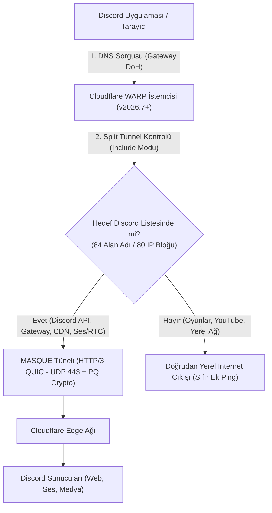
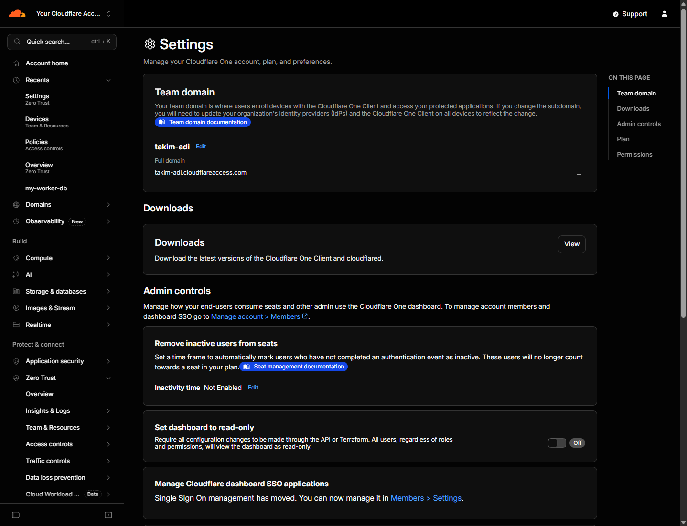
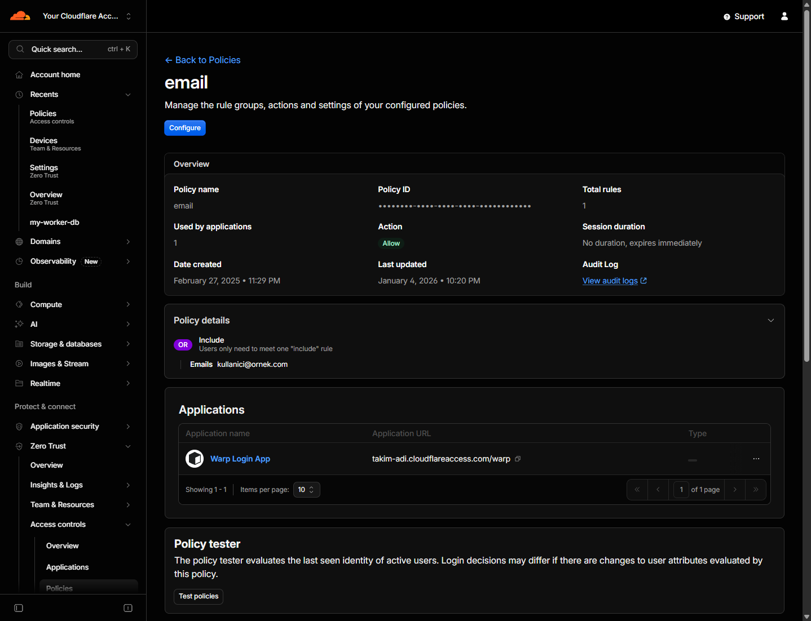
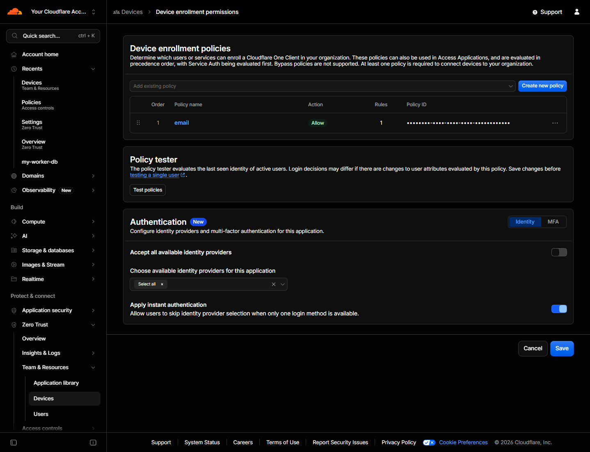
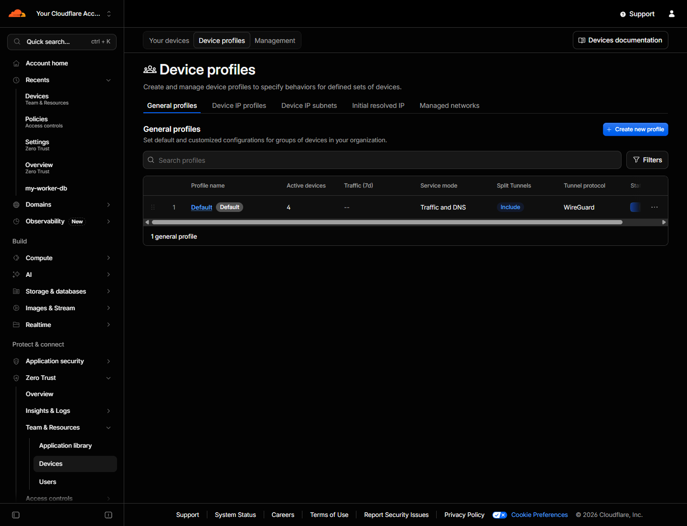
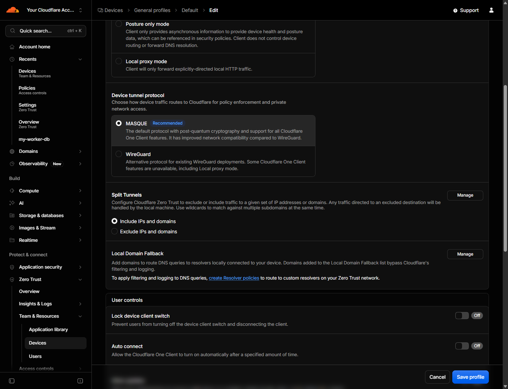

# Cloudflare Zero Trust Üzerinden Discord Trafiğinin Yönlendirilmesi

  <b>🌐 Dil / Language:</b> 🇹🇷 <b>Türkçe</b> | <a href="en/README.md">🇬🇧 English</a>

---

Bu depo, Discord masaüstü istemcisi ve web trafiğinin **Cloudflare Zero Trust (Cloudflare One / WARP v2026.7+)** altyapısı üzerinden seçici olarak (**Split Tunnel — Include modu**) yönlendirilmesine ilişkin uçtan uca teknik dokümantasyonu, güncel ekran görüntülü kurulum rehberini ve PowerShell otomasyon betiklerini içerir.

| Alan | Değer |
|---|---|
| **Belge kimliği** | ZT-GENEL-001 |
| **Sürüm** | 2.0 (Güncel Cloudflare One Panel & WARP v2026.7+) |
| **Yayım tarihi** | 20.11.2026 |
| **Durum** | Yürürlükte |
| **Kapsam** | Windows 10/11 istemcileri, Cloudflare Zero Trust ücretsiz planı |
| **Bakım sorumlusu** | Depo sahibi ([@akaydesu](https://github.com/akaydesu)) |

---

## 1. Amaç

Bu doküman seti, Discord masaüstü uygulamasının (ses/WebRTC dahil) ve web istemcisinin ağ/İSS tabanlı erişim engellerinden, DNS müdahalelerinden veya UDP port kısıtlamalarından etkilenmeden çalışabilmesi için **Cloudflare Zero Trust (Cloudflare One)** üzerinde kurulması gereken yapılandırmayı tanımlar. Kurulum; istemci tabanlı Zero Trust Network Access (ZTNA) modelini esas alır ve cihazdaki diğer uygulamaların hızını veya oyun ping değerini etkilemeden **yalnızca Discord trafiğini** tünele yönlendirir.

Dokümanlar, yapılandırmayı sıfırdan kuracak bir kullanıcının veya teknik personelin ihtiyaç duyduğu tüm adımları **en güncel Cloudflare One arayüz ekran görüntüleri**, protokol karşılaştırma analizleri ve doğrulama komutları ile birlikte sunar.

## 2. Kapsam

### 2.1 Kapsam içi

- Cloudflare Zero Trust organizasyonunun (`<takim-adi>.cloudflareaccess.com`) oluşturulması ve temel ayarları
- Cihaz kayıt (**Device Enrollment**) erişim politikasının (`Access controls > Policies`) tanımlanması ve bağlanması
- Cloudflare One / WARP (`v2026.7+`) istemcisinin kurulumu ve Zero Trust organizasyonuna kaydı
- Cihaz profilinin (`Team & Resources > Devices > Device profiles`) yapılandırılması ve Split Tunnel modunun **Include IPs and domains** olarak seçilmesi
- 164 kurallık Discord IP/CIDR ve alan adı envanterinin (veya 15 kurallık hızlı setin) uygulanması
- Tünel taşıma protokolünün (`Device tunnel protocol`) incelenmesi: Neden **MASQUE (Recommended)** seçilmeli ve **WireGuard** ile arasındaki teknik farklar
- Bağlantının doğrulanması ve olası arızaların giderilmesi
- Yapılandırmanın Cloudflare API ve PowerShell betikleri üzerinden tek komutla otomatik uygulanması

### 2.2 Kapsam dışı

- Discord sunucularının veya botlarının barındırılması
- Cloudflare Tunnel (`cloudflared`) ile dışarıya sunucu hizmeti yayımlanması
- Kurumsal kimlik sağlayıcı (Okta, Entra ID vb. IdP) entegrasyonu
- Windows dışı istemci işletim sistemleri
- Ağ tarafında yerel güvenlik duvarı, proxy veya QoS yapılandırması

## 3. Hedef kitle ve ön koşullar

Uygulama öncesinde aşağıdaki koşullar sağlanmış olmalıdır:

- **Cloudflare hesabı** (<https://dash.cloudflare.com>) ve Zero Trust hizmetine erişim yetkisi
- **Windows 10 veya Windows 11** işletim sistemine sahip istemci bilgisayar
- **Yerel yönetici (Administrator) hakları** (WARP servis kurulumu için)
- **Cloudflare WARP / Cloudflare One İstemcisi** (<https://one.one.one.one/> — sürüm `2026.7+`)
- **Discord uygulaması** (kurulum sırasında kapalı tutulmalı, doğrulama aşamasında açılmalıdır)

## 4. Yöntem özeti ve neden MASQUE protokolü seçilmeli?

Kurulumda üç temel bileşen birlikte çalışır:

1. **Cloudflare WARP İstemcisi (`v2026.7+`):** Cihaz üzerinde sanal ağ arayüzünü oluşturur, tüneli sonlandırır ve işletim sistemi yönlendirme tablosunu yönetir.
2. **Split Tunnel (`Include IPs and domains` Modu):** Hangi hedef IP ve alan adlarının tünele gireceğini belirler. **Include** modunda yalnızca listede tanımlı 164 Discord kuralı tünelden geçer; çevrimiçi oyunlar, tarayıcı ve diğer tüm yerel trafik kendi internet bağlantınızdan doğrudan çıkar.
3. **Tünel Protokolü — MASQUE (`HTTP/3 - UDP/443`):** Cloudflare One panelinde varsayılan ve **Recommended (Önerilen)** olarak işaretlenen protokoldür.

### 4.1 Neden WireGuard yerine MASQUE protokolü daha iyidir?

Cloudflare Zero Trust profil ayarlarında iki protokol seçeneği bulunur: **MASQUE (Recommended)** ve **WireGuard**. Bu kurulumda **MASQUE** protokolünün tercih edilmesinin teknik nedenleri şunlardır:

| Kriter | MASQUE (`Recommended` — Seçilen) | WireGuard (Alternatif) | Neden MASQUE Daha İyi? |
|---|---|---|---|
| **Taşıma Katmanı ve Port** | `UDP/443` üzerinde **HTTP/3 (QUIC)** ve gerekli durumlarda **HTTP/2 (TCP/443) Fallback** | `UDP/2408` (veya sabit özel UDP portları) | `UDP/443` tüm dünyada standart HTTPS/QUIC web trafiği portudur; `UDP/2408` ise İSS'ler tarafından kolayca bloklanır. |
| **DPI (Derin Paket İnceleme) Dayanımı** | Standart TLS 1.3 / HTTP/3 şifreli web trafiği ile **birebir aynı görünür** | WireGuard el sıkışma (handshake) paket imzası DPI cihazlarınca anında tanınır | Ağ daraltmalarına (throttling) ve İSS engellerine karşı MASQUE çok daha yüksek başarı oranına sahiptir. |
| **Discord Ses / WebRTC (`RTC Connecting`) Kararlılığı** | Çoklu QUIC akışı (multiplexing) ve H2 fallback sayesinde ses kanallarında paket kaybını önler | UDP/2408 kısıtlandığında Discord metin kanalları açılsa bile ses `RTC Connecting`'de takılır | Discord ses, yayın ve kamera paylaşımında kesintisiz bağlantı sağlar. |
| **Post-Quantum (Kuantum Sonrası) Şifreleme** | **Varsayılan olarak aktif** (`Post-quantum support for MASQUE: Enabled`, FIPS 140-3 uyumlu) | Sınırlı / eski tip el sıkışma | İstemci (`warp-cli settings`) çıktısında doğrulandığı üzere kuantum sonrası kriptografi (ML-KEM) destekler. |
| **İstemci Özellik Desteği** | Tüm Cloudflare One Client özelliklerini (Local Proxy modu dahil) destekler | Panel uyarısında belirtildiği üzere Local Proxy dahil bazı yeni özellikler kullanılamaz | Geleceğe dönük tüm Zero Trust özellikleri ile tam uyumludur. |

## 5. Doküman seti

| Belge Kodu | Dosya | İçerik Özeti |
|---|---|---|
| **ZT-001** | [01-zero-trust-nedir.md](01-zero-trust-nedir.md) | Zero Trust modeli, VPN ve `cloudflared` farkı, MASQUE vs WireGuard mimari karşılaştırması |
| **ZT-002** | [02-cloudflare-kurulumu.md](02-cloudflare-kurulumu.md) | **Güncel ekran görüntülü** Cloudflare One panel kurulumu (Politika, Cihaz Kaydı, Split Tunnel, MASQUE) |
| **ZT-003** | [03-ip-ve-dns.md](03-ip-ve-dns.md) | 15 kurallık Hızlı Kurulum Seti ve 164 kurallık Tam Discord IP/DNS Envanteri |
| **ZT-004** | [04-warp-kurulumu.md](04-warp-kurulumu.md) | **Güncel ekran görüntülü** WARP `v2026.7+` istemci kurulumu, takım kaydı ve CLI doğrulaması |
| **ZT-005** | [05-sorun-giderme.md](05-sorun-giderme.md) | Belirti, kök neden ve çözüm eşlemesi, RTC/Ses ve DNS teşhis komutları |
| **ZT-006** | [06-otomasyon.md](06-otomasyon.md) | 164 kuralın ve MASQUE protokolünün PowerShell + Cloudflare API ile tek komutla uygulanması |

## 6. Uygulama sırası (Hızlı Başlangıç)

1. **Kavramsal Çerçeve:** [ZT-001 (01-zero-trust-nedir.md)](01-zero-trust-nedir.md) belgesinden mimariyi ve protokol seçimini gözden geçirin.
2. **Panel Yapılandırması:** [ZT-002 (02-cloudflare-kurulumu.md)](02-cloudflare-kurulumu.md) adımlarını takip ederek takım alan adınızı (`Settings > Team domain`) kontrol edin, erişim politikasını (`Access controls > Policies`) oluşturup cihaz kaydına (`Team & Resources > Devices > Management`) bağlayın, cihaz profilinde (`Device profiles > Default`) protokolü **MASQUE** ve Split Tunnel'ı **Include IPs and domains** yapın.
3. **Adres Envanterinin Girilmesi:**
   - **Seçenek A (Otomatik — Önerilen):** [ZT-006 (06-otomasyon.md)](06-otomasyon.md) rehberindeki `scripts/Apply-DiscordZeroTrust.ps1` betiği ile 164 kuralı ve MASQUE protokol ayarını saniyeler içinde API üzerinden yükleyin.
   - **Seçenek B (Manuel):** [ZT-003 (03-ip-ve-dns.md)](03-ip-ve-dns.md) belgesindeki 15 kayıtlık Hızlı Kurulum Setini veya 164 kayıtlık tam listeyi panelden (`Split tunnels > Add split tunnel entries`) ekleyin.
4. **WARP Kurulumu ve Kayıt:** [ZT-004 (04-warp-kurulumu.md)](04-warp-kurulumu.md) adımlarıyla WARP istemcisini kurup takım adınızla (`<takim-adi>.cloudflareaccess.com`) giriş yapın.
5. **Doğrulama:** `scripts/Verify-DiscordTunnel.ps1` betiğini çalıştırarak tüneli test edin.
6. **Sorun Giderme:** Bağlantı veya ses (`RTC Connecting`) sorunu yaşarsanız [ZT-005 (05-sorun-giderme.md)](05-sorun-giderme.md) tablosunu uygulayın.

## 7. Güncel Görsel Kurulum Özeti (Cloudflare One & WARP v2026.7+)

Detaylı açıklamalar için [02-cloudflare-kurulumu.md](02-cloudflare-kurulumu.md) ve [04-warp-kurulumu.md](04-warp-kurulumu.md) belgelerine bakınız:

| Adım | Güncel Ekran Görüntüsü | Açıklama |
|---|---|---|
| **1. Takım Alan Adı (`Team domain`)** |  | `Zero Trust > Settings > Team domain` altında `<takim-adi>.cloudflareaccess.com` adresinizi belirleyin. |
| **2. Erişim Politikası (`Policies`)** |  | `Access controls > Policies` altında `Action: Allow` ve `Include -> Emails: kullanici@ornek.com` kuralını oluşturun. |
| **3. Cihaz Kayıt İzni (`Device enrollment`)** |  | `Team & Resources > Devices > Management > Device enrollment permissions` altında politikanızı bağlayın. |
| **4. Cihaz Profilleri (`Device profiles`)** |  | `Team & Resources > Devices > Device profiles` sekmesinde **Default** profile tıklayın. |
| **5. MASQUE & Split Tunnel (`Include`)** |  | `Edit profile settings` içinde **Device tunnel protocol: MASQUE (Recommended)** ve **Split Tunnels: Include IPs and domains** seçin. |
| **6. Rota Ekleme (`Add split tunnel entries`)** |  | `Split tunnels` sekmesinde **Add split tunnel entries** ile `IP Address` ve `Domain` kayıtlarını ekleyin. |
| **7. Servis Modu & MASQUE Seçimi** |  | `Service mode: Traffic and DNS mode` ve `Device tunnel protocol: MASQUE` seçili olarak **Save profile** düğmesine basın. |

## 8. Güvenlik ve gizlilik notları

- Tüm ekran görüntülerinde hesap kimlikleri, politika/cihaz UUID değerleri ve kişisel e-posta adresleri (`kullanici@ornek.com`, `takim-adi`) maskelenmiştir.
- API anahtarları yalnızca `Apply-DiscordZeroTrust.ps1` çalıştırılırken geçici olarak kullanılmalı ve işlem bitiminde Cloudflare panelinden silinmelidir.
- Ücretsiz plan 50 kullanıcıya kadar destek sunar; kişisel ve küçük ekip kullanımı için tamamen ücretsizdir.

## 9. Kaynakça

- Cloudflare One dokümantasyonu: <https://developers.cloudflare.com/cloudflare-one/>
- Split Tunnels: <https://developers.cloudflare.com/cloudflare-one/connections/connect-devices/warp/configure-warp/route-traffic/split-tunnels/>
- WARP istemcisi indirme sayfası: <https://one.one.one.one/>
