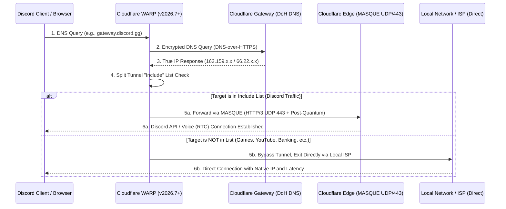

# Zero Trust Model, Protocol Analysis, and Architecture

  <b>🌐 Language / Dil:</b> <a href="../01-zero-trust-nedir.md">🇹🇷 Türkçe</a> | 🇬🇧 <b>English</b>

---

| Field | Value |
|---|---|
| **Document ID** | ZT-001 |
| **Version** | 2.0 (Cloudflare One & WARP v2026.7+) |
| **Release Date** | 2026-11-20 |
| **Related Docs** | [ZT-002](02-cloudflare-setup.md), [ZT-003](03-ip-and-dns.md), [ZT-004](04-warp-setup.md) |

## 1. Objective

This document explains the **Zero Trust Network Access (ZTNA)** model, the Cloudflare One components used, and the technical rationale behind our key architectural decisions—specifically **Split Tunnel Include mode** and the **MASQUE vs. WireGuard tunnel protocol comparison**.

## 2. The Zero Trust Model

### 2.1 Definition

Zero Trust is a modern cybersecurity paradigm based on the principle **"Never trust, always verify"**. Traditional perimeter security assumes everything inside the network is trustworthy. Zero Trust eliminates implicit trust: every access request is continuously validated based on user identity, device registration, and policy rules.

### 2.2 Core Principles

1. **Identity-Based Access:** Access decisions are enforced using user identity (email OTP verification), device registration, and session context.
2. **Least Privilege:** Users and devices only route traffic for explicitly defined resources.
3. **Continuous Verification:** Access is evaluated throughout the session.
4. **Network Segmentation (Split Tunneling):** Traffic is segmented per application and destination; only explicitly listed destinations enter the encrypted tunnel.
5. **Visibility & Auditing:** All enrollments and policy decisions can be audited in the dashboard.

## 3. ZTNA vs. Traditional VPN

| Criterion | Traditional VPN | Zero Trust (ZTNA — Split Tunnel Include) |
|---|---|---|
| **Access Decision** | Anyone connected to the network is trusted | Every device and user is verified via Access policies |
| **Resource Scope** | Full network routing through the VPN server | Only explicitly defined destinations (Discord) |
| **Traffic Scope** | Tunnels 100% of system traffic by default | Tunnels only included destinations (`Include IPs and domains`) |
| **Gaming & Local Latency (Ping)** | Adds VPN routing overhead to all games and apps | Online games and local sites exit directly via your ISP (0 extra ping) |
| **DPI / Port Blocking Resilience** | Standard OpenVPN/WireGuard ports are easily throttled | **MASQUE** (`UDP/443`, HTTP/3) blends in with standard HTTPS web traffic |

## 4. Cloudflare One Components Used

| Component | Latest Dashboard Location | Role in This Setup |
|---|---|---|
| **Team Domain (Organization)** | `Zero Trust > Settings > Team domain` | Organization domain (`<team-name>.cloudflareaccess.com`) for device enrollment |
| **Access Policy** | `Zero Trust > Access controls > Policies` | Defines which email addresses are permitted to enroll WARP clients |
| **Device Enrollment Permissions** | `Zero Trust > Team & Resources > Devices > Management` | Binds the Access policy to Cloudflare One / WARP device enrollment |
| **Device Profile (`Default`)** | `Zero Trust > Team & Resources > Devices > Device profiles` | Holds Service mode (`Traffic and DNS`), tunnel protocol (`MASQUE`), and Split Tunnel settings |
| **Split Tunnel (`Include`)** | `Device profiles > Default > Split tunnels` | Ensures only the 84 Discord domains and 80 IP/CIDR blocks enter the tunnel |
| **MASQUE Protocol** | `Device profiles > Default > Edit profile settings` | Transports tunnel packets over HTTP/3 (`UDP/443`) with post-quantum encryption |

## 5. Cloudflare Tunnel (`cloudflared`) vs. WARP

Two distinct Cloudflare products are frequently confused. This setup uses the **Cloudflare One Client (WARP)**; it does **not** use `cloudflared`.

| Product | Traffic Direction | Purpose |
|---|---|---|
| **Cloudflare Tunnel (`cloudflared`)** | Inbound | Exposes a locally hosted server/service to the public Internet |
| **WARP + Zero Trust** | Outbound | Routes a client device's outbound traffic through Cloudflare's edge |

## 6. Traffic Flow

## 7. Design Decisions & Why MASQUE is Superior to WireGuard

### 7.1 Selecting "Include IPs and domains" for Split Tunnels

- In **Include mode**, only destinations explicitly listed enter the tunnel.
- In **Exclude mode**, all computer traffic except the excluded list is tunneled.
- For a Discord-focused setup, **Include IPs and domains** is essential so that online games, streaming platforms, and local LAN traffic are completely unaffected.

### 7.2 Combining Domain and IP/CIDR Rules

Domain rules depend on OS and WARP DNS resolution. Because DNS responses can be cached or tampered with—and because Discord voice servers open direct UDP sockets to raw IP addresses—domain rules alone are insufficient. Therefore, we combine:
- **84 domains** (`discord.com`, `*.discord.gg`, `*.discordapp.net`, etc.) for Web, API, and CDN,
- **32 Cloudflare anycast IPv4 blocks** (`162.159.128.0/19`, `104.18.0.0/20`, etc.) for frontend and Gateway endpoints,
- **32 Discord Voice / RTC IPv4 blocks** (`66.22.196.0/22` - `66.22.248.0/24`) for voice, video, and screen sharing,
- **11 Google Cloud IPv4 blocks** (`34.x`, `35.x`) for attachments and backend media services.

### 7.3 Tunnel Protocol Comparison: Why Choose MASQUE Over WireGuard?

In the Cloudflare Zero Trust device profile editor (`Edit "Default" profile > Device tunnel protocol`), two options are presented: **MASQUE (`Recommended`)** and **WireGuard**.

Here is the detailed technical breakdown of why **MASQUE (Multiplexed Application Substrate over QUIC Encryption)** is superior to WireGuard:

1. **Stealth Against DPI and Port Blocking (`UDP/443` vs. `UDP/2408`):**
   - **WireGuard** operates over `UDP/2408` (or distinct non-standard UDP ports) and uses an unencrypted, easily identifiable packet header signature during its handshake. ISPs, campus/dorm networks, and firewalls using Deep Packet Inspection (DPI) can trivially fingerprint, throttle, or drop WireGuard packets.
   - **MASQUE** is an IETF standard protocol that encapsulates traffic inside **HTTP/3 (QUIC) over `UDP/443`**. To any external network observer or ISP firewall, MASQUE traffic looks identical to a standard encrypted HTTPS/QUIC connection to a modern website.
2. **Automatic HTTP/2 (`TCP/443`) Fallback:**
   - In WARP `v2026.7+` (verified in `warp-cli settings` as `HTTP Version: MASQUE (HTTP/3 with HTTP/2 fallback)`), if an aggressive network completely blocks all UDP traffic, MASQUE automatically falls back to `TCP/443` (HTTP/2) so your connection never drops. WireGuard is strictly UDP-only and fails completely if UDP is blocked.
3. **Eliminates Discord Voice (`RTC Connecting`) Hangs:**
   - When WireGuard is throttled by an ISP, Discord text messages may still load slowly while voice channels get stuck indefinitely on **`RTC Connecting`** or suffer severe robotic voice distortion. MASQUE's QUIC stream multiplexing transports Discord WebRTC voice and stream packets without throttling.
4. **Built-in Post-Quantum Cryptography (PQC):**
   - As highlighted in the Cloudflare One dashboard (*"The default protocol with post-quantum cryptography and support for all Cloudflare One Client features"*), MASQUE enables hybrid post-quantum key exchange (`ML-KEM` / `X25519MLKEM768`) by default.
5. **Full Cloudflare One Client Feature Compatibility:**
   - The dashboard explicitly warns under WireGuard: *"Some Cloudflare One Client features are unavailable, including Local proxy mode."* MASQUE supports 100% of modern Cloudflare One features.

## 8. Related Documents

- Next Step (Dashboard Setup): [02-cloudflare-setup.md](02-cloudflare-setup.md)
- Address Inventory: [03-ip-and-dns.md](03-ip-and-dns.md)
- Client Setup: [04-warp-setup.md](04-warp-setup.md)
