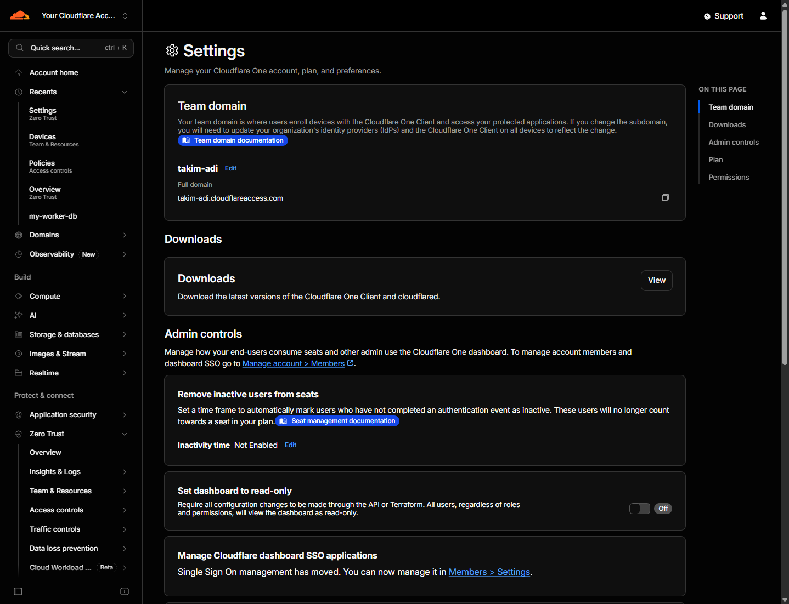
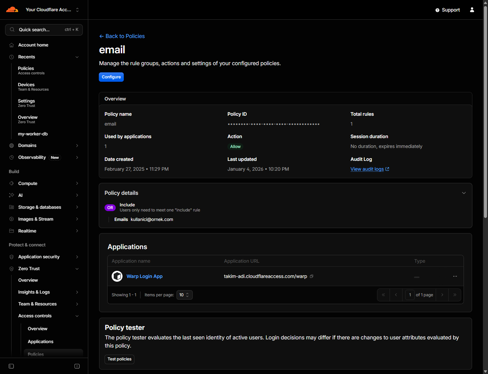
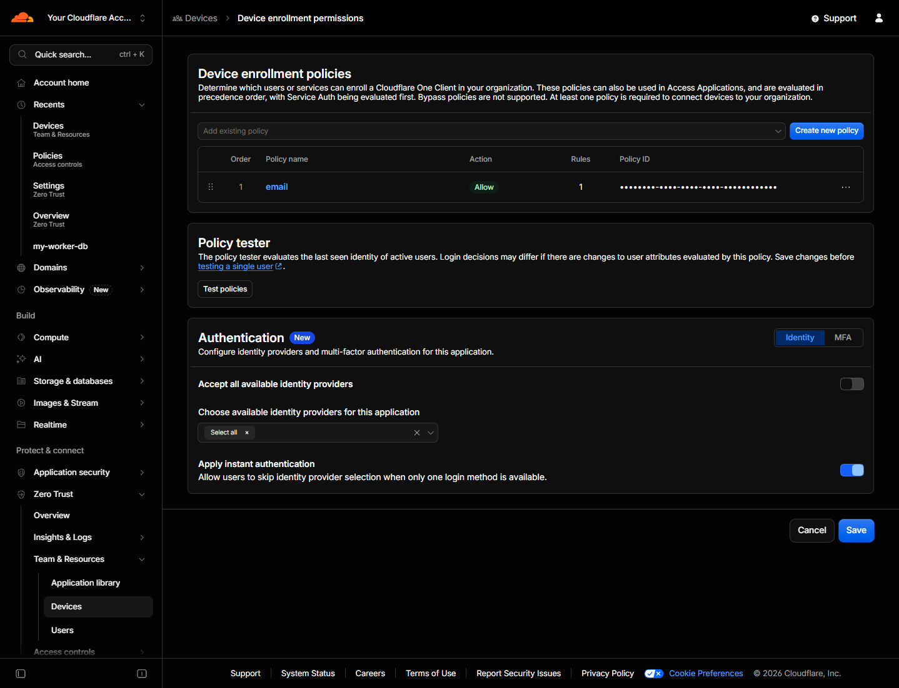
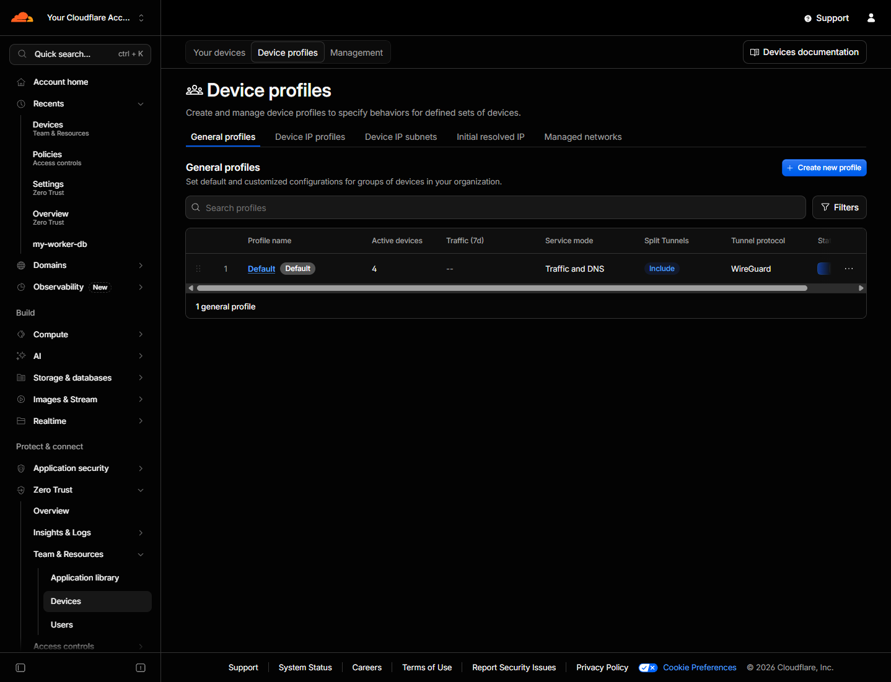
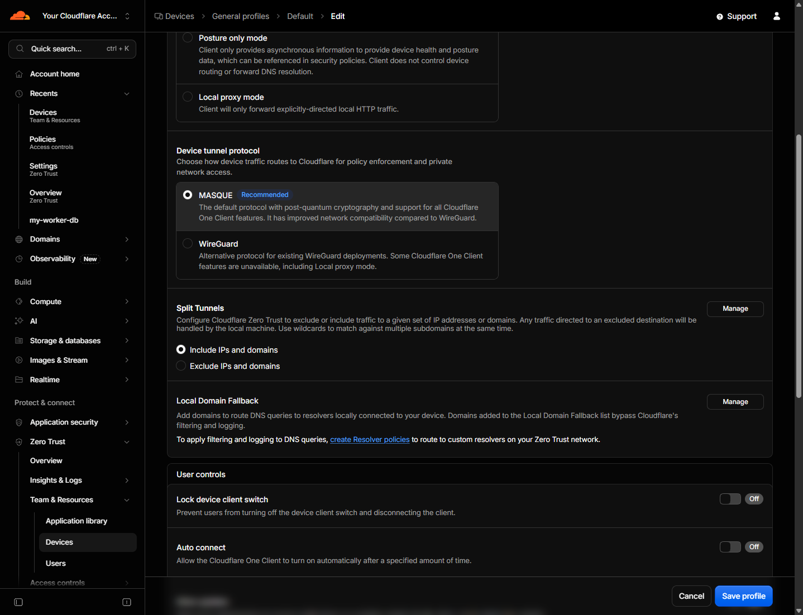

# Cloudflare Zero Trust (Cloudflare One) Dashboard Configuration

  <b>🌐 Language / Dil:</b> <a href="../02-cloudflare-kurulumu.md">🇹🇷 Türkçe</a> | 🇬🇧 <b>English</b>

---

| Field | Value |
|---|---|
| **Document ID** | ZT-002 |
| **Version** | 2.0 (Latest Cloudflare One Dashboard) |
| **Release Date** | 2026-11-20 |
| **Estimated Time** | 10 - 15 minutes |
| **Related Docs** | [ZT-001](01-what-is-zero-trust.md), [ZT-003](03-ip-and-dns.md), [ZT-004](04-warp-setup.md), [ZT-006](06-automation.md) |

## 1. Objective

This document provides a step-by-step visual walkthrough of the required configuration in the latest Cloudflare Zero Trust (**Cloudflare One**) dashboard. Upon completion, your organization (`Team domain`), access policy (`Access controls > Policies`), device enrollment permissions (`Device enrollment`), Split Tunnel Include list, and **MASQUE** tunnel protocol will be ready.

## 2. Prerequisites

- Cloudflare account (<https://dash.cloudflare.com>)
- Access to the Zero Trust service
- Address inventory from [ZT-003](03-ip-and-dns.md) (or the automated script in [ZT-006](06-automation.md))
- Keep the Discord application **closed** during configuration

---

## 3. Creating the Organization & Verifying Your `Team domain`

### 3.1 Accessing Zero Trust

1. Sign in to <https://dash.cloudflare.com>.
2. From the left sidebar under **Protect & connect**, click **Zero Trust**.
3. If this is your first time using Zero Trust, complete the onboarding wizard by choosing a team name and selecting the **Zero Trust Free** plan ($0/month, up to 50 users).

### 3.2 Verifying Your Team Domain (`Team domain`)

1. Navigate to **Zero Trust > Settings** from the left menu.
2. Under the **Team domain** card, verify your team subdomain (`<team-name>.cloudflareaccess.com`):

- **Important:** Note your `<team-name>` prefix (e.g., `takim-adi` in `takim-adi.cloudflareaccess.com`). You will enter this name when enrolling your WARP desktop client into Zero Trust.

---

## 4. Defining an Access Policy (`Access controls > Policies`)

By default, Zero Trust blocks all devices from enrolling. You must create an Access policy permitting your email address before connecting your computer.

### 4.1 Creating a Reusable Policy

1. Navigate to **Zero Trust > Access controls > Policies** (`Reusable policies` tab).
2. Click **+ Add a policy** in the top right (or click **Configure** on an existing policy).
3. Configure the policy fields as shown below:

| Field | Value | Description |
|---|---|---|
| **Policy Name** | `email` or `discord-enroll` | Descriptive name for your enrollment policy |
| **Action** | `Allow` | Grants enrollment permission to matching users |
| **Session duration** | `No duration, expires immediately` or `24 hours` | Enrollment session validity |
| **Policy rules > Include** | `Selector: Emails` → `Value: kullanici@ornek.com` | The active email address where you will receive your one-time login PIN |

4. Save the policy.

---

## 5. Attaching Device Enrollment Permissions (`Device enrollment permissions`)

Next, bind your Access policy to Cloudflare One / WARP device enrollment.

> [!IMPORTANT]
> If this step is skipped, the WARP client cannot enroll into your organization and will fail with **"Forbidden"** or **"Unable to connect"**.

1. Navigate to **Zero Trust > Team & Resources > Devices** in the left sidebar.
2. Switch to the **Management** tab at the top.
3. Next to **Device enrollment > Device enrollment permissions**, click **Manage**.
4. Under **Device enrollment policies**, select your policy (`email` / `discord-enroll`) from the `Add existing policy` dropdown:

5. Click **Save** at the bottom right.

---

## 6. Configuring the Device Profile, MASQUE Protocol, and Split Tunnels

By default, WARP tunnels 100% of your internet traffic. To prevent extra latency in online games, tunnel **only Discord**, and bypass ISP UDP throttling, we configure the **Default** device profile.

### 6.1 Opening the Default Device Profile

1. Go to **Zero Trust > Team & Resources > Devices** and select the **Device profiles** tab at the top.
2. Under **General profiles**, click on the **Default** profile:

3. On the **Default** profile details page, click **Edit profile settings** in the top right corner.

### 6.2 Setting Service Mode and Selecting MASQUE (`Recommended`) Protocol

At the top of the `Edit "Default" profile` screen, configure **Service mode** and **Device tunnel protocol**:

1. **Service mode:** Select **`Traffic and DNS mode`** (routes included IP traffic and resolves DNS via Cloudflare DoH).
2. **Device tunnel protocol:** Select **`MASQUE` (`Recommended`)**.

#### Why Select MASQUE Instead of WireGuard?

In the latest Cloudflare One dashboard, **MASQUE** carries the **`Recommended`** badge with the description: *"The default protocol with post-quantum cryptography and support for all Cloudflare One Client features. It has improved network compatibility compared to WireGuard."*

- **Key Technical Advantages of MASQUE:**
  1. **Standard HTTPS/QUIC Footprint (`UDP/443`):** WireGuard runs on `UDP/2408`, which ISPs and firewalls easily detect and throttle using Deep Packet Inspection (DPI). **MASQUE** encapsulates traffic inside **HTTP/3 (QUIC) over `UDP/443`**, making your tunnel traffic look identical to standard encrypted web traffic.
  2. **Automatic HTTP/2 (`TCP/443`) Fallback:** Even if a restrictive network completely blocks UDP, MASQUE automatically falls back to `TCP/443` (HTTP/2) without dropping your session.
  3. **Fixes Discord Voice (`RTC Connecting`) Issues:** The #1 cause of Discord voice channels getting stuck on `RTC Connecting` is ISP throttling of WireGuard UDP packets. MASQUE resolves this completely.
  4. **Post-Quantum Cryptography (PQC) & Full Feature Support:** MASQUE includes built-in post-quantum encryption (`ML-KEM`) and supports all Cloudflare One Client features (whereas WireGuard disables features such as `Local proxy mode`).

### 6.3 Setting Split Tunnels to "Include IPs and domains"

1. Scroll down on the same `Edit "Default" profile` page to the **Split Tunnels** section.
2. Select **`Include IPs and domains`** and click **Save profile** at the bottom right:

| Mode | Behavior | Recommendation |
|---|---|---|
| **Exclude IPs and domains** | Tunnels **all system traffic** except listed destinations | ❌ Do not use |
| **Include IPs and domains** | Tunnels **only listed** IPs and domains | ✅ **Required for Discord-only tunneling** |

---

## 7. Adding Discord IP and Domain Entries

> [!TIP]
> **Automated Deployment (Recommended):** Instead of pasting 164 IP addresses and domains one by one in the UI, save the **Include IPs and domains** and **MASQUE** settings above, then run `Apply-DiscordZeroTrust.ps1` from [06-automation.md](06-automation.md) to push all 164 rules automatically in 10 seconds!

If you prefer adding rules **manually** via the dashboard:

1. In `Devices > General profiles > Default`, open the **Split tunnels** tab at the top (or click **Manage** next to Split Tunnels).
2. Click **Add split tunnel entries** in the top right:

3. In the **Add split tunnel entries** form:
   - For an **IP address or CIDR block** (e.g., `162.159.128.0/19`, `66.22.192.0/18`): Set **Selector** to **`IP Address`**, paste the value, and click **Add to list**.
   - For a **Domain** (e.g., `discord.com`, `*.discord.com`, `*.discord.gg`): Set **Selector** to **`Domain`**, paste the domain, and click **Add to list**.
4. Once all entries from [03-ip-and-dns.md](03-ip-and-dns.md) are added, click **Save entries**.

---

## 8. Configuration Verification Checklist

| # | Check | Dashboard Location | Expected State |
|---|---|---|---|
| **1** | Team domain | `Zero Trust > Settings > Team domain` | `<team-name>.cloudflareaccess.com` active |
| **2** | Access policy | `Zero Trust > Access controls > Policies` | `Allow` rule with your email defined |
| **3** | Enrollment permission | `Zero Trust > Team & Resources > Devices > Management` | Policy attached under `Device enrollment permissions` |
| **4** | Tunnel protocol | `Devices > Device profiles > Default > Edit profile settings` | **MASQUE (`Recommended`)** |
| **5** | Split Tunnel mode | `Devices > Device profiles > Default > Edit profile settings` | **Include IPs and domains** |
| **6** | Address inventory | `Devices > Device profiles > Default > Split tunnels` | At least the 15-rule Quick Set or 164-rule Full Set loaded |

## 9. Related Documents

- Previous Document (Architecture & Protocol Analysis): [01-what-is-zero-trust.md](01-what-is-zero-trust.md)
- Address & Domain Inventory: [03-ip-and-dns.md](03-ip-and-dns.md)
- Next Step (WARP Client Setup): [04-warp-setup.md](04-warp-setup.md)
- Automated API Deployment: [06-automation.md](06-automation.md)
