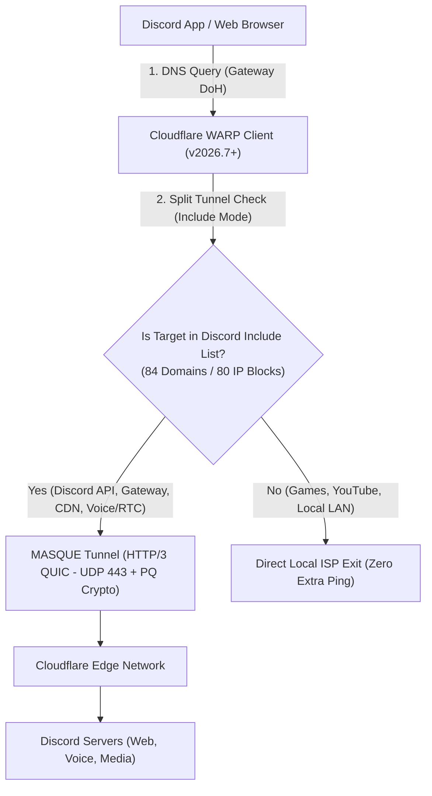
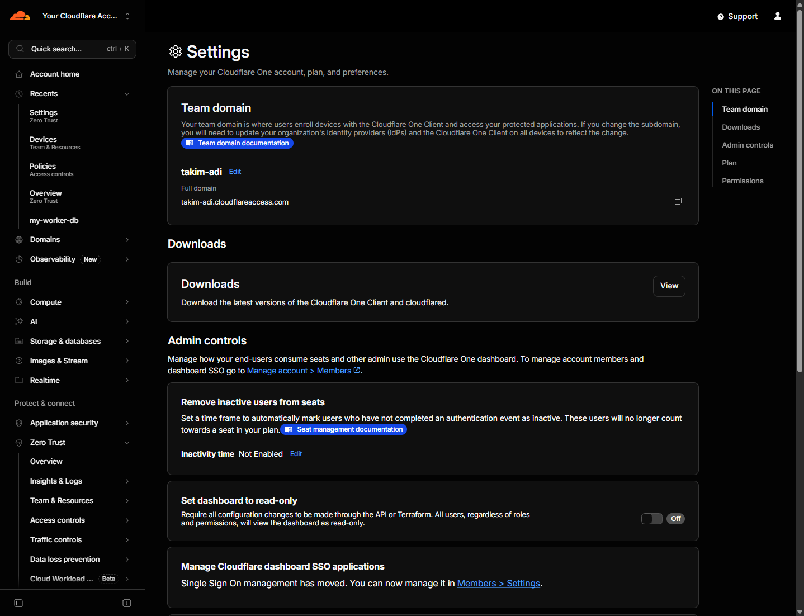
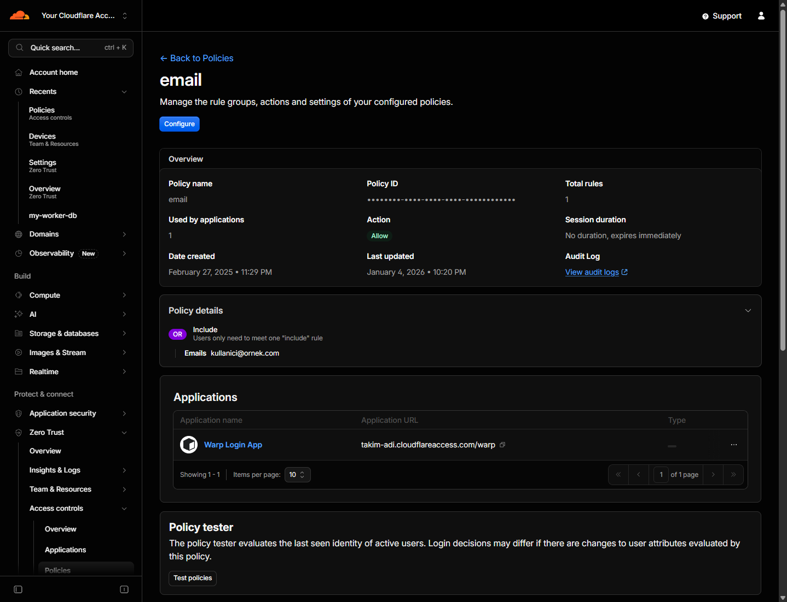
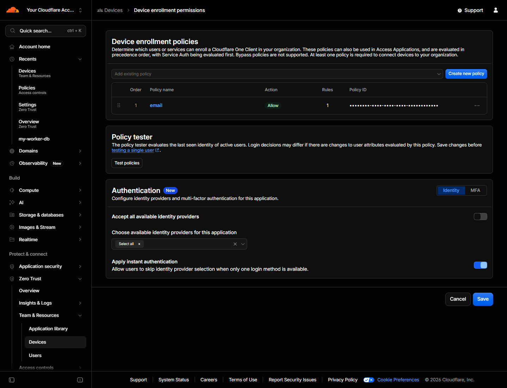
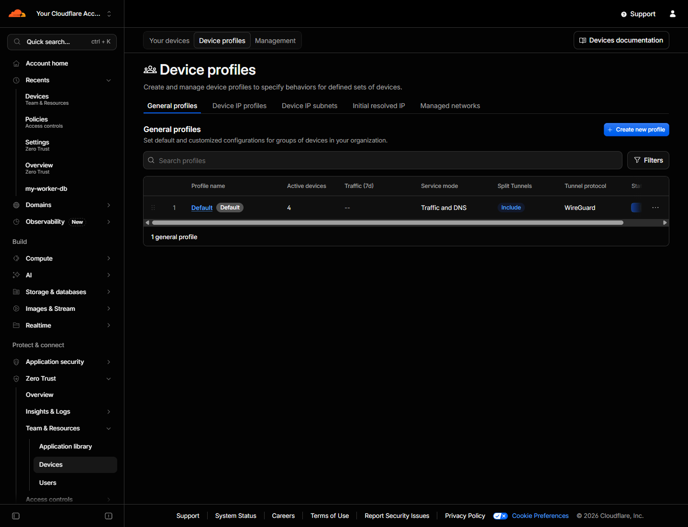
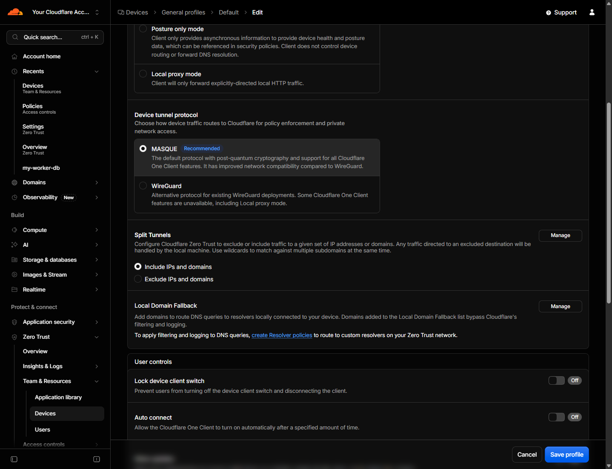
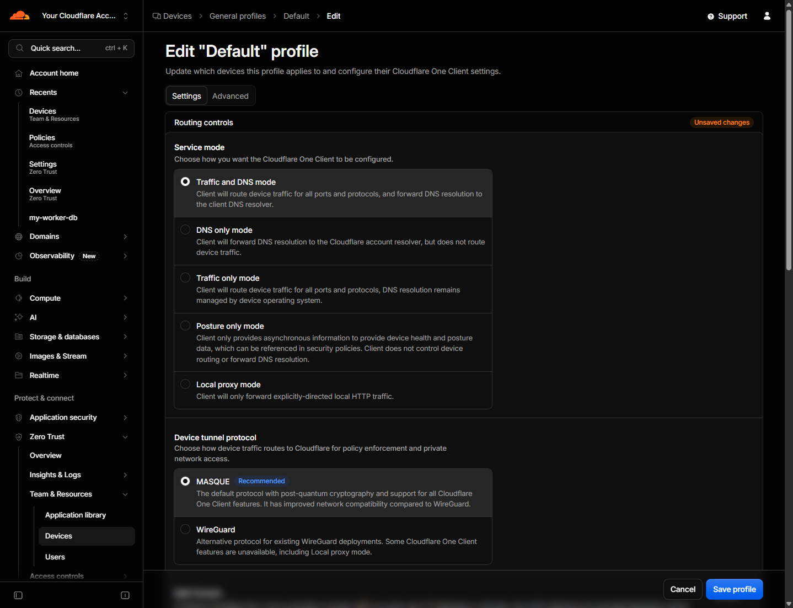

# Routing Discord Traffic via Cloudflare Zero Trust

  <b>🌐 Language / Dil:</b> <a href="../README.md">🇹🇷 Türkçe</a> | 🇬🇧 <b>English</b>

---

This repository contains the end-to-end technical documentation, screenshot-guided setup manual (latest **Cloudflare One** dashboard & **WARP `v2026.7+`**), and PowerShell automation scripts for selectively routing Discord desktop and web client traffic through **Cloudflare Zero Trust** (**Split Tunnel — Include mode**).

| Field | Value |
|---|---|
| **Document ID** | ZT-GEN-001 |
| **Version** | 2.0 (Latest Cloudflare One Dashboard & WARP v2026.7+) |
| **Release Date** | 2026-11-20 |
| **Status** | Active |
| **Scope** | Windows 10/11 clients, Cloudflare Zero Trust Free Plan |
| **Maintainer** | Repository Owner ([@akaydesu](https://github.com/akaydesu)) |

---

## 1. Objective

This documentation set defines the required **Cloudflare Zero Trust (Cloudflare One)** configuration to allow the Discord desktop application (including voice/WebRTC) and web client to operate reliably without being affected by ISP/network blocks, DNS tampering, or UDP port throttling. The setup follows a client-based Zero Trust Network Access (ZTNA) model and routes **only Discord traffic** through the tunnel, leaving all other applications and online games on your direct local internet connection with zero extra latency.

Every procedure is documented step-by-step with **up-to-date Cloudflare One dashboard screenshots**, protocol comparison analysis (**MASQUE vs. WireGuard**), and verification commands.

## 2. Scope

### 2.1 In Scope

- Creating and configuring a Cloudflare Zero Trust organization (`<team-name>.cloudflareaccess.com`)
- Defining and attaching a **Device Enrollment** access policy (`Access controls > Policies`)
- Installing the Cloudflare One / WARP (`v2026.7+`) client and enrolling it into the Zero Trust organization
- Configuring the device profile (`Team & Resources > Devices > Device profiles`) and setting Split Tunnels to **Include IPs and domains**
- Applying the 164-rule Discord IP/CIDR and domain inventory (or the 15-rule Quick Setup Set)
- Evaluating the device tunnel protocol (`Device tunnel protocol`): Why **MASQUE (Recommended)** is superior to **WireGuard**
- Verifying connectivity and troubleshooting common issues
- Automating the entire configuration via Cloudflare API and PowerShell scripts

### 2.2 Out of Scope

- Hosting Discord servers or bots
- Publishing inbound server services via Cloudflare Tunnel (`cloudflared`)
- Enterprise Identity Provider (Okta, Entra ID, etc.) integration
- Non-Windows client operating systems
- Local network firewall, proxy, or QoS configuration

## 3. Target Audience and Prerequisites

Before starting, ensure the following prerequisites are met:

- **Cloudflare account** (<https://dash.cloudflare.com>) with access to Zero Trust
- **Windows 10 or Windows 11** client machine
- **Local Administrator privileges** (required for installing the WARP service)
- **Cloudflare WARP / Cloudflare One Client** (<https://one.one.one.one/> — version `2026.7+`)
- **Discord application** (keep closed during setup; launch during the verification step)

## 4. Method Overview & Why Choose the MASQUE Protocol?

Three core components work together in this setup:

1. **Cloudflare WARP Client (`v2026.7+`):** Establishes the virtual network interface on the device, terminates the tunnel, and manages the OS routing table.
2. **Split Tunnel (`Include IPs and domains` Mode):** Determines which destination IPs and domains enter the tunnel. In **Include** mode, only the 164 defined Discord rules pass through the tunnel; online games, browsers, and all other local traffic exit directly through your ISP.
3. **Tunnel Protocol — MASQUE (`HTTP/3 - UDP/443`):** Marked as the default and **Recommended** protocol in the Cloudflare One dashboard.

### 4.1 Why is MASQUE better than WireGuard?

In Cloudflare Zero Trust device profile settings, two tunnel protocols are available: **MASQUE (Recommended)** and **WireGuard**. Here is why **MASQUE** is the superior choice for this setup:

| Criterion | MASQUE (`Recommended` — Selected) | WireGuard (Alternative) | Why MASQUE is Better |
|---|---|---|---|
| **Transport Layer & Port** | **HTTP/3 (QUIC)** over `UDP/443` with automatic **HTTP/2 (`TCP/443`) Fallback** | `UDP/2408` (or specific custom UDP ports) | `UDP/443` is the universal port for standard HTTPS/QUIC web traffic, whereas `UDP/2408` is easily blocked by ISPs. |
| **DPI (Deep Packet Inspection) Resilience** | Indistinguishable from standard TLS 1.3 / HTTP/3 encrypted web browsing | Distinct WireGuard handshake packet signature is immediately fingerprinted by DPI | MASQUE bypasses ISP UDP throttling and protocol blocks with much higher reliability. |
| **Discord Voice / WebRTC (`RTC Connecting`) Stability** | QUIC stream multiplexing and H2 fallback prevent packet loss on voice channels | When `UDP/2408` is throttled, Discord text channels load but voice hangs on `RTC Connecting` | Ensures crystal-clear, uninterrupted Discord voice, screen sharing, and video calls. |
| **Post-Quantum Cryptography (PQC)** | **Enabled by default** (`Post-quantum support for MASQUE: Enabled`, FIPS 140-3 compliant) | Limited / legacy handshake | Protects tunnel traffic with hybrid post-quantum key exchange (`ML-KEM`). |
| **Client Feature Support** | Supports all Cloudflare One Client features (including Local Proxy mode) | As noted in the dashboard, some features (including Local Proxy mode) are unavailable | Full compatibility with all modern Zero Trust client capabilities. |

## 5. Documentation Set

| Doc ID | File | Summary |
|---|---|---|
| **ZT-001** | [01-what-is-zero-trust.md](01-what-is-zero-trust.md) | Zero Trust model, VPN & `cloudflared` comparison, MASQUE vs. WireGuard architectural analysis |
| **ZT-002** | [02-cloudflare-setup.md](02-cloudflare-setup.md) | **Screenshot-guided** Cloudflare One dashboard setup (Policies, Enrollment, Split Tunnel, MASQUE) |
| **ZT-003** | [03-ip-and-dns.md](03-ip-and-dns.md) | 15-rule Quick Setup Set and 164-rule Full Discord IP/DNS Inventory |
| **ZT-004** | [04-warp-setup.md](04-warp-setup.md) | WARP `v2026.7+` client installation, organization enrollment, and CLI verification |
| **ZT-005** | [05-troubleshooting.md](05-troubleshooting.md) | Symptom, root cause, and resolution matrix, RTC/Voice and DNS diagnostic commands |
| **ZT-006** | [06-automation.md](06-automation.md) | Automated deployment of all 164 rules and MASQUE protocol via PowerShell + Cloudflare API |

## 6. Execution Order (Quick Start)

1. **Architecture & Protocol Review:** Read [ZT-001 (01-what-is-zero-trust.md)](01-what-is-zero-trust.md).
2. **Dashboard Configuration:** Follow [ZT-002 (02-cloudflare-setup.md)](02-cloudflare-setup.md) to verify your team domain (`Settings > Team domain`), create an access policy (`Access controls > Policies`), attach it to device enrollment (`Team & Resources > Devices > Management`), and configure the `Default` profile (`Device profiles > Default`) with **MASQUE** and **Include IPs and domains**.
3. **Applying the Address Inventory:**
   - **Option A (Automated — Recommended):** Run `scripts/Apply-DiscordZeroTrust.ps1` as documented in [ZT-006 (06-automation.md)](06-automation.md) to push all 164 rules and enable MASQUE via the Cloudflare API in seconds.
   - **Option B (Manual):** Add the 15-rule Quick Setup Set or 164-rule Full Inventory from [ZT-003 (03-ip-and-dns.md)](03-ip-and-dns.md) under `Split tunnels > Add split tunnel entries`.
4. **WARP Installation & Enrollment:** Follow [ZT-004 (04-warp-setup.md)](04-warp-setup.md) to install WARP and enroll using `<team-name>.cloudflareaccess.com`.
5. **Verification:** Run `scripts/Verify-DiscordTunnel.ps1` to verify the tunnel end-to-end.
6. **Troubleshooting:** Refer to [ZT-005 (05-troubleshooting.md)](05-troubleshooting.md) if you encounter connection or `RTC Connecting` voice issues.

## 7. Visual Setup Summary (Latest Cloudflare One Dashboard)

See [02-cloudflare-setup.md](02-cloudflare-setup.md) for detailed instructions:

| Step | Dashboard Screenshot | Description |
|---|---|---|
| **1. Team Domain** |  | Verify `<team-name>.cloudflareaccess.com` under `Zero Trust > Settings > Team domain`. |
| **2. Access Policy (`Policies`)** |  | Create an `Allow` policy under `Access controls > Policies` with `Include -> Emails: kullanici@ornek.com`. |
| **3. Device Enrollment Permissions** |  | Attach your policy under `Team & Resources > Devices > Management > Device enrollment permissions`. |
| **4. Device Profiles** |  | Open the **Default** profile under `Team & Resources > Devices > Device profiles`. |
| **5. MASQUE & Split Tunnel (`Include`)** |  | In `Edit profile settings`, select **Device tunnel protocol: MASQUE (Recommended)** and **Split Tunnels: Include IPs and domains**. |
| **6. Add Split Tunnel Entries** |  | In the `Split tunnels` tab, click **Add split tunnel entries** to add `IP Address` and `Domain` rules. |
| **7. Service Mode & MASQUE Selection** |  | Confirm `Service mode: Traffic and DNS mode` and `Device tunnel protocol: MASQUE`, then click **Save profile**. |

## 8. Security & Privacy Notes

- All account IDs, policy/device UUIDs, and personal email addresses (`kullanici@ornek.com`, `takim-adi`) in the screenshots have been sanitized/redacted.
- API tokens should only be used temporarily when running `Apply-DiscordZeroTrust.ps1` and deleted from the Cloudflare dashboard immediately afterward.
- The Cloudflare Zero Trust Free plan supports up to 50 users at $0/month.

## 9. References

- Cloudflare One documentation: <https://developers.cloudflare.com/cloudflare-one/>
- Split Tunnels: <https://developers.cloudflare.com/cloudflare-one/connections/connect-devices/warp/configure-warp/route-traffic/split-tunnels/>
- WARP Client download: <https://one.one.one.one/>
